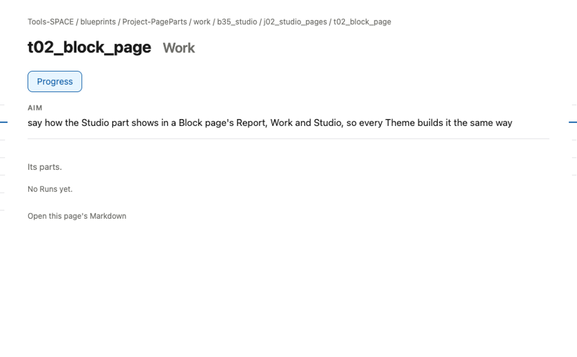
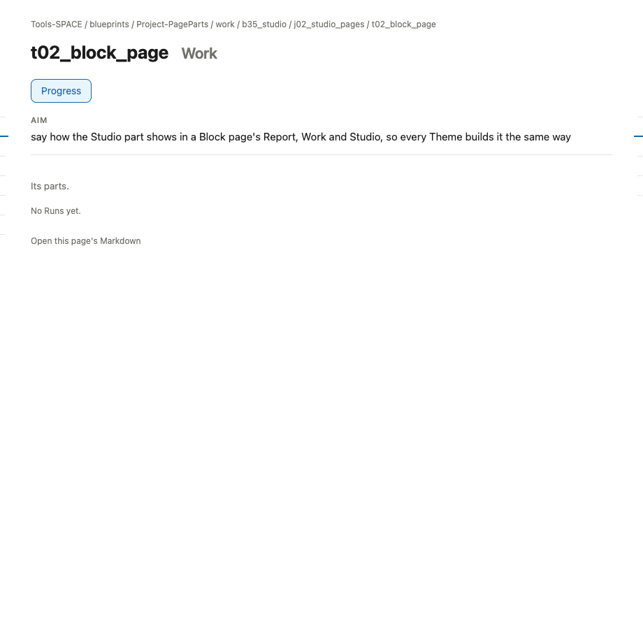

# s18 · Task UI: Work <!-- root #dc3f4f -->

**Stage:** explore
**Tags:** Task UI

- For <!-- @for #f78806 -->
  - a deck, and the rules for how … <!-- @for/0 #a326dc -->
    a deck, and the rules for how the Studio part shows in a Task's Work (do), for every Theme that builds that page
- Delivery type <!-- @delivery-type #58a44f -->
  - ui <!-- @delivery-type/0 #636117 -->
- Covers <!-- @covers #a6c44a -->
  - where an sNN appears in a Task … <!-- @covers/0 #3bc37e -->
    where an sNN appears in a Task page's Work, and what it shows there.
- Excluded <!-- @excluded #980495 -->
  - the other eight cells (s11 to s19); … <!-- @excluded/0 #bb465d -->
    the other eight cells (s11 to s19); the page's own content, which each Theme designs (b16, b17).
- Topic <!-- @topic #7e13bd -->
  - how the Studio part shows in a … <!-- @topic/0 #1a93be -->
    how the Studio part shows in a Task page's Work, read from the real page (t02_block_page) so every Theme builds it the same way (JL 261031: "please add more subgroup of the UI ... to direct others how to make the UI for the report and work").
- Feeds <!-- @feeds #ffe8e9 -->
  - none: b35 keeps no Questions <!-- @feeds/0 #5c9a70 -->
- Rules <!-- @rules #bb11a8 -->
  - One row per Run: its name, then … <!-- @rules/0 #072f0b -->
    One row per Run: its name, then status · agent · skill from its run.yaml (b35-s01-D18).
  - A Task with no Run says "No … <!-- @rules/1 #57f0be -->
    A Task with no Run says "No Runs yet."
- Files <!-- @files #6ce6c5 -->
  - delivery/ <!-- @files/0 #404761 -->
  - [excalidraw] [s18-task-ui-work.excalidraw](s18-task-ui-work.excalidraw) <!-- @files/1 #8da29e -->
  - [md] [s18-task-ui-work.md](s18-task-ui-work.md) <!-- @files/2 #e5c803 -->
  - [png] [s18-task-ui-work.png](s18-task-ui-work.png) <!-- @files/3 #9f6446 -->
    
  - [png] [screen.png](screen.png) <!-- @files/4 #986ba8 -->
    
- Decided <!-- @decided #55615a -->
  - (none yet) <!-- @decided/0 #ac326f -->
- Open <!-- @open #cf9b77 -->
  - Should a Run row name the sNN … <!-- @open/0 #ff01d1 -->
    Should a Run row name the sNN it serves?
