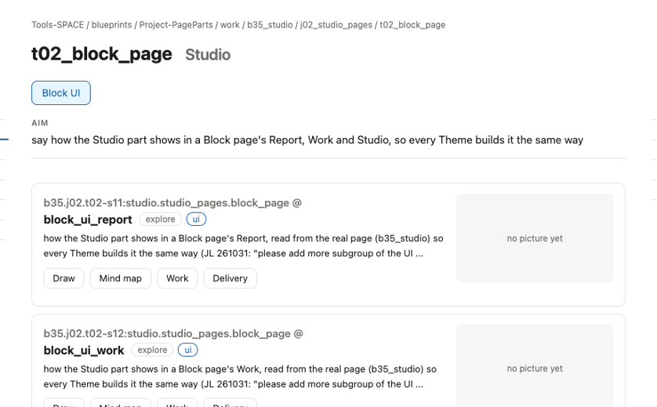
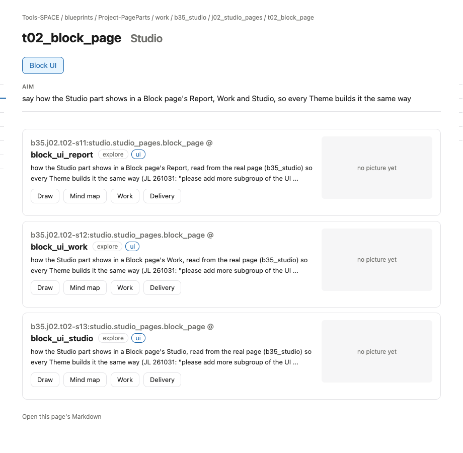

# s19 · Task UI: Studio <!-- root #460660 -->

**Stage:** explore
**Tags:** Task UI

- For <!-- @for #f78806 -->
  - a deck, and the rules for how … <!-- @for/0 #2d352a -->
    a deck, and the rules for how the Studio part shows in a Task's Studio (think), for every Theme that builds that page
- Delivery type <!-- @delivery-type #58a44f -->
  - ui <!-- @delivery-type/0 #636117 -->
- Covers <!-- @covers #a6c44a -->
  - where an sNN appears in a Task … <!-- @covers/0 #cc2d66 -->
    where an sNN appears in a Task page's Studio, and what it shows there.
- Excluded <!-- @excluded #980495 -->
  - the other eight cells (s11 to s19); … <!-- @excluded/0 #bb465d -->
    the other eight cells (s11 to s19); the page's own content, which each Theme designs (b16, b17).
- Topic <!-- @topic #7e13bd -->
  - how the Studio part shows in a … <!-- @topic/0 #2888f9 -->
    how the Studio part shows in a Task page's Studio, read from the real page (t02_block_page) so every Theme builds it the same way (JL 261031: "please add more subgroup of the UI ... to direct others how to make the UI for the report and work").
- Feeds <!-- @feeds #ffe8e9 -->
  - none: b35 keeps no Questions <!-- @feeds/0 #5c9a70 -->
- Rules <!-- @rules #bb11a8 -->
  - One group button per Tag of the … <!-- @rules/0 #d22316 -->
    One group button per Tag of the Task's own sNN (at most 3).
  - The cards are the Block's cards; the … <!-- @rules/1 #162d52 -->
    The cards are the Block's cards; the drawing is the cell's five parts.
- Files <!-- @files #6ce6c5 -->
  - delivery/ <!-- @files/0 #404761 -->
  - [excalidraw] [s19-task-ui-studio.excalidraw](s19-task-ui-studio.excalidraw) <!-- @files/1 #822549 -->
  - [md] [s19-task-ui-studio.md](s19-task-ui-studio.md) <!-- @files/2 #2fa345 -->
  - [png] [s19-task-ui-studio.png](s19-task-ui-studio.png) <!-- @files/3 #7933c9 -->
    
  - [png] [screen.png](screen.png) <!-- @files/4 #986ba8 -->
    
- Decided <!-- @decided #55615a -->
  - (none yet) <!-- @decided/0 #ac326f -->
- Open <!-- @open #cf9b77 -->
  - When a Task holds one sNN only, … <!-- @open/0 #85e549 -->
    When a Task holds one sNN only, should Studio open straight on its card?
