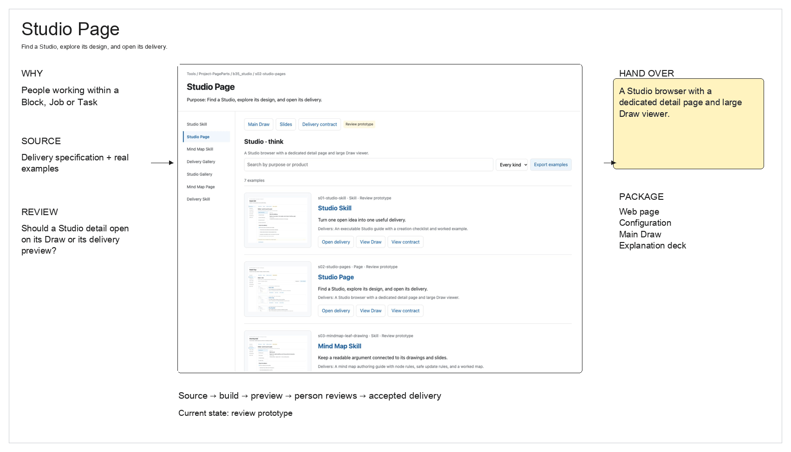
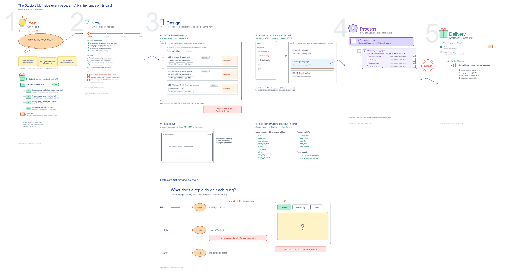

# What does a topic do on each rung?

What is settled about the topic page first, then what a topic is for on each rung, then what a reader sees first.

- [workflow] The total workflow <!-- n01 -->
  → What is a topic for on each rung?
  - [agreed] No studio/ folder; At: hangs a topic on a rung. <!-- n02 -->
  - [retired] No page of its own; a link opens its card (D05). <!-- n03 -->
  - [agreed] Its card's name opens the face, popped out. <!-- n04 -->
  - [retired] The mind map pops out from the card (D05). <!-- n05 -->
- [rungs] What is a topic for on each rung? <!-- n06 -->
  → What does a reader see first?
  - [open] Does a Job page list its Tasks' topics? <!-- n07 -->
  - [leaning] Block: a design question for the whole Block. <!-- n08 -->
  - [leaning] Job: how its Tasks fit together. <!-- n09 -->
  - [leaning] Task: one figure or table to agree. <!-- n10 -->
- [page] What does a reader see first? <!-- n11 -->
  - [open] Does the Decided list stay on the face? <!-- n12 -->
  - [leaning] Ideas: the slide, large, with its question. <!-- n13 -->
  - [option] Mind map: the whole topic as a tree. <!-- n14 -->
  - [option] Open: what the person owes. <!-- n15 -->
- Files <!-- @files -->
  - [md] [s02-studio-pages.md](s02-studio-pages.md) <!-- @files/0 -->
  - delivery/ <!-- @files/1 #404761 -->
  - [excalidraw] [delivery-design.excalidraw](delivery-design.excalidraw) <!-- @files/2 #4a50bf -->
  - [png] [delivery-design.png](delivery-design.png) <!-- @files/3 #42ba68 -->
    
  - map/ <!-- @files/4 #bf7843 -->
  - result/ <!-- @files/5 #d4a42c -->
  - [excalidraw] [s02-studio-pages.excalidraw](s02-studio-pages.excalidraw) <!-- @files/6 #7377e1 -->
  - [md] [s02-studio-pages.ideas.md](s02-studio-pages.ideas.md) <!-- @files/7 #8c7c6c -->
  - [md] [s02-studio-pages.md](s02-studio-pages.md) <!-- @files/8 #5fffa7 -->
  - [png] [s02-studio-pages.png](s02-studio-pages.png) <!-- @files/9 #b0ae56 -->
    
  - [html] [s02-studio-pages.slides.html](s02-studio-pages.slides.html) <!-- @files/10 #35b4ba -->
  - [json] [s02-studio-pages.slides.json](s02-studio-pages.slides.json) <!-- @files/11 #465b33 -->
  - [pptx] [s02-studio-pages.slides.pptx](s02-studio-pages.slides.pptx) <!-- @files/12 #ba8c2d -->
  - slides/ <!-- @files/13 #0e8ebe -->
