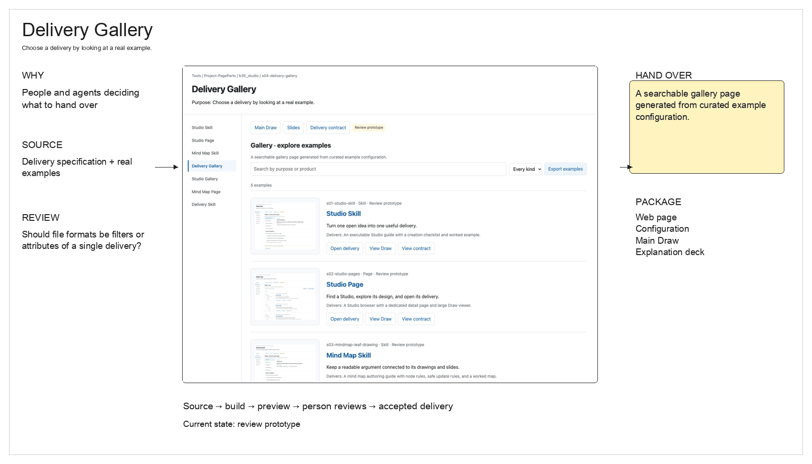
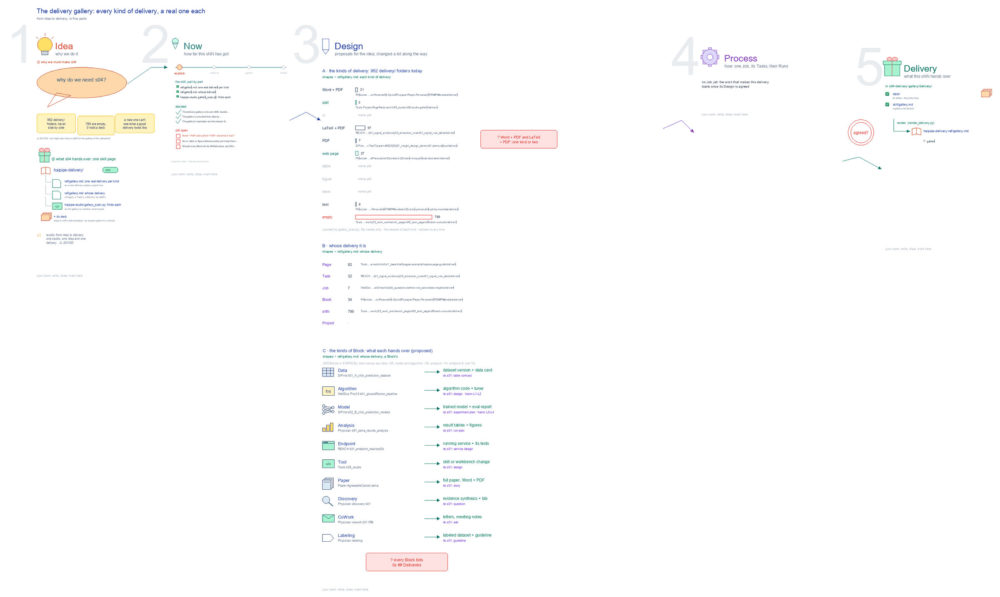

# s04 · Delivery gallery: one real delivery per kind <!-- root #3ca6a1 -->

**Stage:** explore
**Tags:** Delivery

- For <!-- @for #f78806 -->
  - a deck, and a gallery page in … <!-- @for/0 #15c689 -->
    a deck, and a gallery page in the haipipe-delivery skill (`ref/gallery.md`, counted by haipipe-studio `scripts/gallery_scan.py`): one real delivery per kind (Word + PDF, LaTeX + PDF, web page, deck, skill, ...) and whose it is, for anyone about to hand something over.
- Delivery type <!-- @delivery-type #58a44f -->
  - skill <!-- @delivery-type/0 #34b33e -->
- Covers <!-- @covers #a6c44a -->
  - the kinds of delivery found on disk; … <!-- @covers/0 #030083 -->
    the kinds of delivery found on disk; whose delivery it is (a Page's, a Task's, a Block's, a Job's, an sNN's); the kinds of Block and what each hands over.
- Excluded <!-- @excluded #980495 -->
  - how an sNN's `delivery/` renders out, and … <!-- @excluded/0 #b29aa3 -->
    how an sNN's `delivery/` renders out, and the one-delivery rule ([b35-s01:studio @ studio_skill](../s01-studio-skill/s01-studio-skill.md)); building a paper's Word and PDF (haipipe-paper-assemble); the kinds of sNN ([b35-s05:studio @ studio_gallery](../s05-studio-gallery/s05-studio-gallery.md)).
- Topic <!-- @topic #7e13bd -->
  - one real delivery of each kind, to … <!-- @topic/0 #8bf77b -->
    one real delivery of each kind, to copy from.
  - JL 261030: "we might also have a … <!-- @topic/1 #34bf3b -->
    JL 261030: "we might also have a sNN for the gallery of the deliveries, and gallery of the studios, as the new sNN".
  - Every sNN now ends in a delivery, … <!-- @topic/2 #d69043 -->
    Every sNN now ends in a delivery, yet nobody can see the deliveries that exist side by side: 165 `delivery/` folders in 6 SPACEs (scan of 261030), most of them a Page's LaTeX and PDF.
  - A gallery shows one real delivery of … <!-- @topic/3 #8a19a6 -->
    A gallery shows one real delivery of each kind, so a new one copies a good one.
  - The kinds of Block, once sketch F2 … <!-- @topic/4 #6f716b -->
    The kinds of Block, once sketch F2 in b35-s01, moved here.
- Feeds <!-- @feeds #ffe8e9 -->
  - haipipe-delivery `ref/gallery.md` <!-- @feeds/0 #cab25c -->
- Files <!-- @files #6ce6c5 -->
  - [py] [build_s04_delivery_gallery.py](build_s04_delivery_gallery.py) <!-- @files/0 #91a17d -->
  - delivery/ <!-- @files/1 #404761 -->
  - [excalidraw] [delivery-design.excalidraw](delivery-design.excalidraw) <!-- @files/2 #4a50bf -->
  - [png] [delivery-design.png](delivery-design.png) <!-- @files/3 #42ba68 -->
    
  - result/ <!-- @files/4 #d4a42c -->
  - [excalidraw] [s04-delivery-gallery.excalidraw](s04-delivery-gallery.excalidraw) <!-- @files/5 #683fdc -->
  - [md] [s04-delivery-gallery.ideas.md](s04-delivery-gallery.ideas.md) <!-- @files/6 #9e6569 -->
  - [md] [s04-delivery-gallery.md](s04-delivery-gallery.md) <!-- @files/7 #612bc9 -->
  - [png] [s04-delivery-gallery.png](s04-delivery-gallery.png) <!-- @files/8 #eb2d7a -->
    
  - [html] [s04-delivery-gallery.slides.html](s04-delivery-gallery.slides.html) <!-- @files/9 #fe6ca1 -->
  - [json] [s04-delivery-gallery.slides.json](s04-delivery-gallery.slides.json) <!-- @files/10 #b54733 -->
  - [pptx] [s04-delivery-gallery.slides.pptx](s04-delivery-gallery.slides.pptx) <!-- @files/11 #b1f311 -->
- Decided <!-- @decided #55615a -->
  - s04-D01 · The delivery gallery is its … <!-- @decided/0 #b9df0c -->
    s04-D01 · The delivery gallery is its own sNN, beside the studio gallery (s05); b35-s01's sketch F2, the kinds of Block and what each hands over, moved here (JL 261030: "we might also have a sNN for the gallery of the deliveries, and gallery of the studios, as the new sNN").
  - s04-D02 · The gallery is counted from … <!-- @decided/1 #088474 -->
    s04-D02 · The gallery is counted from disk by `gallery_scan.py`, folder and file names only, never a file's content and never `_WorkSpace/`; a SPACE inside a SPACE is a copy and is skipped.
  - s04-D03 · The gallery's examples are the … <!-- @decided/2 #76b54d -->
    s04-D03 · The gallery's examples are the newest of each kind from the scan, never one of the two galleries, and one that names its delivery comes first; `gallery_scan.py --write` writes `delivery/skill/gallery.md` on every rebuild of the drawing, and `render_delivery.py` renders it into haipipe-delivery `ref/gallery.md`. Tools is a public repository, so an sNN from another SPACE shows only its path, never its face's words (JL 261030: "go ahead and do it", agreeing to take the newest real one of each kind).
- Open <!-- @open #cf9b77 -->
  - Word + PDF and LaTeX + PDF: … <!-- @open/0 #054e74 -->
    Word + PDF and LaTeX + PDF: one kind or two?
  - No ui, table or figure delivery exists … <!-- @open/1 #6884b6 -->
    No ui, table or figure delivery exists yet: keep them as kinds in the gallery?
  - Should every Block list its ## Deliveries, … <!-- @open/2 #5870b8 -->
    Should every Block list its ## Deliveries, as b35's board.md does?
- Delivery preview <!-- @delivery-preview #fb4837 -->
  - **Target delivery:** A searchable gallery page generated … <!-- @delivery-preview/0 #24ac2d -->
    **Target delivery:** A searchable gallery page generated from curated example configuration.
  - **Reader:** People and agents deciding what to … <!-- @delivery-preview/1 #b50513 -->
    **Reader:** People and agents deciding what to hand over.
  - **State:** review prototype; not accepted or released <!-- @delivery-preview/2 #bb975f -->
  - [Open delivery](delivery/web/index.html) <!-- @delivery-preview/3 #96c864 -->
  - [Main delivery Draw](delivery-design.excalidraw) <!-- @delivery-preview/4 #6ee145 -->
  - [Draw preview](delivery-design.png) <!-- @delivery-preview/5 #69abaa -->
    
  - [Explanation slides](delivery/deck/index.html) <!-- @delivery-preview/6 #30a56d -->
  - [Delivery contract](delivery/web/contract.html) <!-- @delivery-preview/7 #6d9550 -->
  - The source is `../scripts/delivery-specs.json` <!-- @delivery-preview/8 #50ea71 -->
    The source is `../scripts/delivery-specs.json`; `../scripts/build_delivery_previews.py` generates the review package. Earlier drawings remain unchanged.
