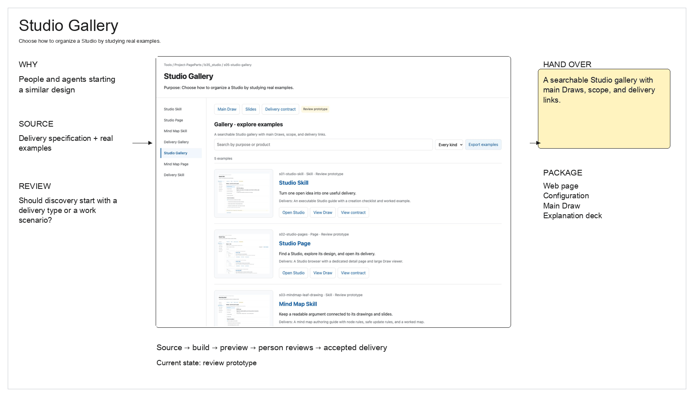
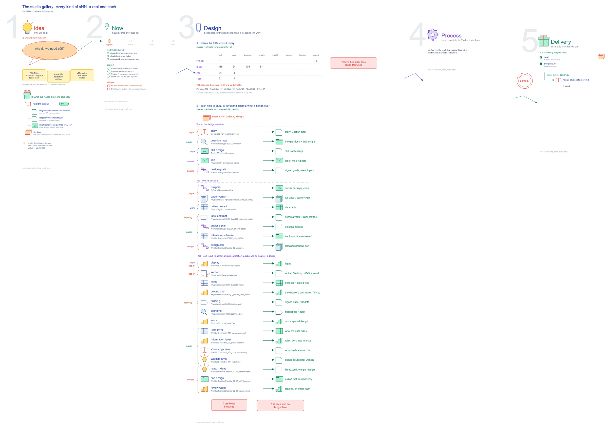

# s05 · Studio gallery: one real sNN per kind <!-- root #d0ff0a -->

**Stage:** explore
**Tags:** Studio

- For <!-- @for #f78806 -->
  - a deck, and a gallery page in … <!-- @for/0 #b8b320 -->
    a deck, and a gallery page in the haipipe-studio skill (`ref/gallery.md`, counted by `scripts/gallery_scan.py`): one real sNN per kind, by level and Theme, for anyone starting a new sNN.
- Delivery type <!-- @delivery-type #58a44f -->
  - skill <!-- @delivery-type/0 #34b33e -->
- Covers <!-- @covers #a6c44a -->
  - where the sNN sit today (level, Theme, … <!-- @covers/0 #ab7101 -->
    where the sNN sit today (level, Theme, SPACE); the kinds of sNN at each level and what each hands over; one real example each.
- Excluded <!-- @excluded #980495 -->
  - what an sNN is and its rules … <!-- @excluded/0 #e0af2a -->
    what an sNN is and its rules ([b35-s01:studio @ studio_skill](../s01-studio-skill/s01-studio-skill.md)); its page and card ([b35-s02:studio @ studio_pages](../s02-studio-pages/s02-studio-pages.md)); the deliveries ([b35-s04:studio @ delivery_gallery](../s04-delivery-gallery/s04-delivery-gallery.md)).
- Topic <!-- @topic #7e13bd -->
  - one real sNN of each kind, to … <!-- @topic/0 #bb46d1 -->
    one real sNN of each kind, to copy from.
  - JL 261030: "we might also have a … <!-- @topic/1 #069b19 -->
    JL 261030: "we might also have a sNN for the gallery of the deliveries, and gallery of the studios, as the new sNN". 638 sNN sit in 6 SPACEs (scan of 261030), and a new one starts from nothing.
  - Earlier JL called s01's scenarios "more like … <!-- @topic/2 #64408a -->
    Earlier JL called s01's scenarios "more like the galleries, ... like different types of the sNN in different settings"; that catalogue, sketch F1 in b35-s01, moved here.
- Feeds <!-- @feeds #ffe8e9 -->
  - haipipe-studio `ref/gallery.md` <!-- @feeds/0 #142962 -->
- Files <!-- @files #6ce6c5 -->
  - [py] [build_s05_studio_gallery.py](build_s05_studio_gallery.py) <!-- @files/0 #6d57e5 -->
  - delivery/ <!-- @files/1 #404761 -->
  - [excalidraw] [delivery-design.excalidraw](delivery-design.excalidraw) <!-- @files/2 #4a50bf -->
  - [png] [delivery-design.png](delivery-design.png) <!-- @files/3 #42ba68 -->
    
  - result/ <!-- @files/4 #d4a42c -->
  - [excalidraw] [s05-studio-gallery.excalidraw](s05-studio-gallery.excalidraw) <!-- @files/5 #e43585 -->
  - [md] [s05-studio-gallery.ideas.md](s05-studio-gallery.ideas.md) <!-- @files/6 #99e6a5 -->
  - [md] [s05-studio-gallery.md](s05-studio-gallery.md) <!-- @files/7 #357a62 -->
  - [png] [s05-studio-gallery.png](s05-studio-gallery.png) <!-- @files/8 #b7a703 -->
    
  - [html] [s05-studio-gallery.slides.html](s05-studio-gallery.slides.html) <!-- @files/9 #1f3c3e -->
  - [json] [s05-studio-gallery.slides.json](s05-studio-gallery.slides.json) <!-- @files/10 #c2349c -->
  - [pptx] [s05-studio-gallery.slides.pptx](s05-studio-gallery.slides.pptx) <!-- @files/11 #757d2e -->
- Decided <!-- @decided #55615a -->
  - s05-D01 · The studio gallery is its … <!-- @decided/0 #db7a55 -->
    s05-D01 · The studio gallery is its own sNN, beside the delivery gallery (s04); b35-s01's sketch F1, each kind of sNN by level and Theme, moved here (JL 261030: "we might also have a sNN for the gallery of the deliveries, and gallery of the studios, as the new sNN").
  - s05-D02 · The counts are read from … <!-- @decided/1 #c15f2d -->
    s05-D02 · The counts are read from disk by `gallery_scan.py` on every rebuild, never typed.
  - s05-D03 · The gallery's examples are the … <!-- @decided/2 #cdda3e -->
    s05-D03 · The gallery's examples are the newest of each kind from the scan, never one of the two galleries, and one that names its delivery comes first; `gallery_scan.py --write` writes `delivery/skill/gallery.md` on every rebuild of the drawing, and `render_delivery.py` renders it into haipipe-studio `ref/gallery.md`. Tools is a public repository, so an sNN from another SPACE shows only its path, never its face's words (JL 261030: "go ahead and do it", agreeing to take the newest real one of each kind).
  - s05-D04 · No sNN sits in a … <!-- @decided/3 #2b0d28 -->
    s05-D04 · No sNN sits in a `studio/` folder any more, so the gallery shows each where it sits, beside its Jobs or Tasks (JL 261031, b35 r02: "We will not have the studio anymore").
- Open <!-- @open #cf9b77 -->
  - Are these the kinds, and is each … <!-- @open/0 #a2a5fd -->
    Are these the kinds, and is each kind on its right level?
  - Should a gallery card show the example's … <!-- @open/1 #6a0cc5 -->
    Should a gallery card show the example's drawing, or only its name and delivery?
- Delivery preview <!-- @delivery-preview #fb4837 -->
  - **Target delivery:** A searchable Studio gallery with … <!-- @delivery-preview/0 #52580b -->
    **Target delivery:** A searchable Studio gallery with main Draws, scope, and delivery links.
  - **Reader:** People and agents starting a similar … <!-- @delivery-preview/1 #c87df9 -->
    **Reader:** People and agents starting a similar design.
  - **State:** review prototype; not accepted or released <!-- @delivery-preview/2 #bb975f -->
  - [Open delivery](delivery/web/index.html) <!-- @delivery-preview/3 #96c864 -->
  - [Main delivery Draw](delivery-design.excalidraw) <!-- @delivery-preview/4 #6ee145 -->
  - [Draw preview](delivery-design.png) <!-- @delivery-preview/5 #69abaa -->
    
  - [Explanation slides](delivery/deck/index.html) <!-- @delivery-preview/6 #30a56d -->
  - [Delivery contract](delivery/web/contract.html) <!-- @delivery-preview/7 #6d9550 -->
  - The source is `../scripts/delivery-specs.json` <!-- @delivery-preview/8 #50ea71 -->
    The source is `../scripts/delivery-specs.json`; `../scripts/build_delivery_previews.py` generates the review package. Earlier drawings remain unchanged.
