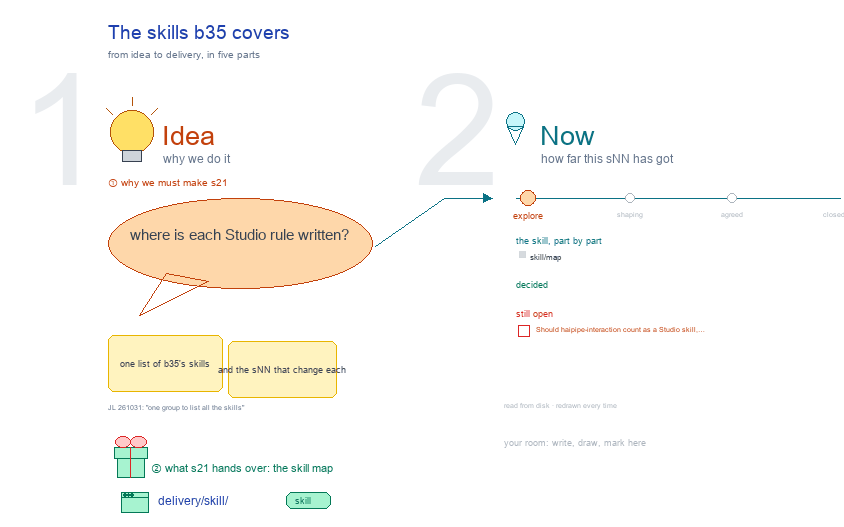

# s21 · The skills b35 covers <!-- root #f56323 -->

**Stage:** explore
**Tags:** Skills

- For <!-- @for #f78806 -->
  - a deck, and the map of b35's … <!-- @for/0 #75bf4c -->
    a deck, and the map of b35's skills: each skill, its version, what it owns, its scripts, and the sNN that change it, for anyone looking for where a Studio rule lives
- Delivery type <!-- @delivery-type #58a44f -->
  - skill <!-- @delivery-type/0 #34b33e -->
- Covers <!-- @covers #a6c44a -->
  - the four skills whose rules b35's topics … <!-- @covers/0 #7cde7c -->
    the four skills whose rules b35's topics settle, read from disk on every build.
- Excluded <!-- @excluded #980495 -->
  - haipipe-display's slide part (b34_display s02); haipipe-interaction (b10); … <!-- @excluded/0 #f048a3 -->
    haipipe-display's slide part (b34_display s02); haipipe-interaction (b10); the workbench server code, which s02 and j02 change.
- Topic <!-- @topic #7e13bd -->
  - one place that lists every skill this … <!-- @topic/0 #23ad23 -->
    one place that lists every skill this Block covers, so a reader sees where each Studio rule is written and which sNN changes it (JL 261031: "could you have one group to list all the skills? the skills covered by this b35_studio").
- Feeds <!-- @feeds #ffe8e9 -->
  - none: b35 keeps no Questions <!-- @feeds/0 #5c9a70 -->
- Skills <!-- @skills #e09212 -->
  - haipipe-studio · fed by s01, s04, s05 … <!-- @skills/0 #d740e8 -->
    haipipe-studio · fed by s01, s04, s05 · what an sNN is, its face, numbering, drawings and builders
  - haipipe-mindmap · fed by s03, s08 · … <!-- @skills/1 #bcc670 -->
    haipipe-mindmap · fed by s03, s08 · a topic's mind map: structure, one drawing per leaf, the map page
  - haipipe-delivery · fed by s04, s09 · … <!-- @skills/2 #544356 -->
    haipipe-delivery · fed by s04, s09 · each level's delivery/: where it goes, its version, who marks it sent
  - excalidraw-studio · fed by s01 · how … <!-- @skills/3 #be2ae8 -->
    excalidraw-studio · fed by s01 · how every topic's drawing looks: the five parts (b35-s01-D16)
- Files <!-- @files #6ce6c5 -->
  - [py] [build_s21_studio_skills.py](build_s21_studio_skills.py) <!-- @files/0 #660de6 -->
  - delivery/ <!-- @files/1 #404761 -->
  - [excalidraw] [s21-studio-skills.excalidraw](s21-studio-skills.excalidraw) <!-- @files/2 #fa2302 -->
  - [md] [s21-studio-skills.md](s21-studio-skills.md) <!-- @files/3 #5d6300 -->
  - [png] [s21-studio-skills.png](s21-studio-skills.png) <!-- @files/4 #87f3bf -->
    
- Decided <!-- @decided #55615a -->
  - (none yet) <!-- @decided/0 #ac326f -->
- Open <!-- @open #cf9b77 -->
  - Should haipipe-interaction count as a Studio skill, … <!-- @open/0 #e9cc4e -->
    Should haipipe-interaction count as a Studio skill, since every interaction now hangs on an sNN?
