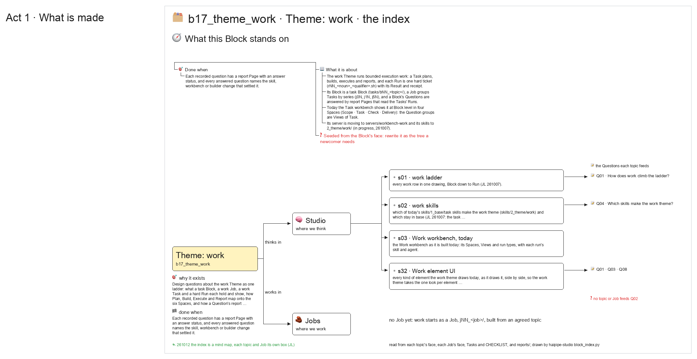

# s00 · Background and index <!-- root #791011 -->

**Stage:** shaping

- Topic <!-- @topic #7e13bd -->
  - what this Block stands on, for a … <!-- @topic/0 #cb7bb4 -->
    what this Block stands on, for a reader new to it, and an index of its studio topics (sNN), Jobs (jNN) and Questions (qNN) with how far each has come.
  - The background is the yaml below, written … <!-- @topic/1 #343de9 -->
    The background is the yaml below, written by a person; the index is read from disk on every build (JL 2026-10-12: "for every block, we also want to have the s00-background-and-index").
- Feeds <!-- @feeds #ffe8e9 -->
  - none; it indexes the whole Block <!-- @feeds/0 #952c0b -->
- Files <!-- @files #6ce6c5 -->
  - [py] [build_s00_background_and_index.py](build_s00_background_and_index.py) <!-- @files/0 #e05012 -->
  - [excalidraw] [s00-background-and-index.excalidraw](s00-background-and-index.excalidraw) <!-- @files/1 #fb3adb -->
  - [md] [s00-background-and-index.md](s00-background-and-index.md) <!-- @files/2 #e328ee -->
  - [png] [s00-background-and-index.png](s00-background-and-index.png) <!-- @files/3 #20b395 -->
    
- Background <!-- @background #64dd60 -->
  - One frame per entry, two at most, … <!-- @background/0 #03851d -->
    One frame per entry, two at most, each a folder tree: a string is a leaf, `{label: [children]}` a branch; an emoji leads each node (🧭 📖 🎯 🧱 …), and a leaf that starts with "❓" is still open and draws red. Without an `intro`, the first frame opens with the Block's spine.
- Open <!-- @open #cf9b77 -->
  - The background was seeded from the Block's … <!-- @open/0 #4a3a0a -->
    The background was seeded from the Block's face on 2026-10-12: a person rewrites it as the tree a newcomer needs.
