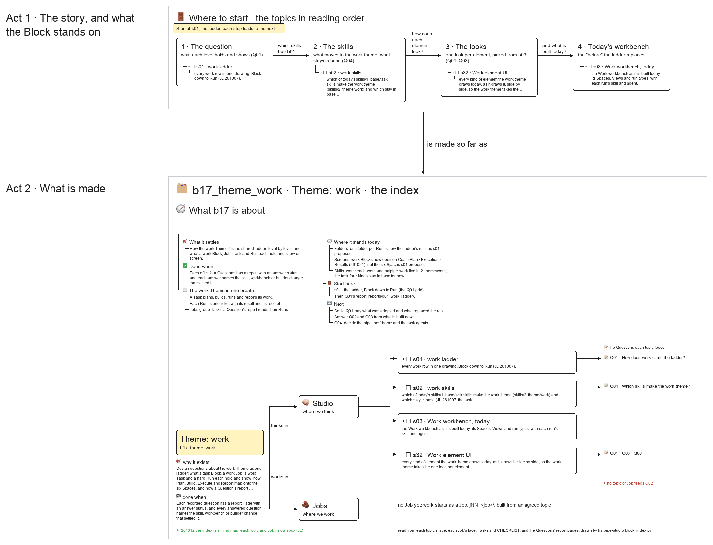

# s00 · What b17 stands on

Background for a newcomer, where to start, what comes next, and an index of the Block's topics and Questions.

- [about] The work Theme runs bounded work <!-- n01 -->
  → How is that work laid out on disk?
  - [task] A Task plans, builds, executes, reports <!-- n02 -->
  - [run] One hard ticket per Run, with its Result <!-- n03 -->
    A Run is one hard ticket, `rNN_<noun>_<qualifier>.sh`, with its Result and its receipt.
- [shape] Block, Job, Task, Run <!-- n04 -->
  → What does the workbench show of it today?
  - [block] A task Block: tasks/bNN_<topic>/ <!-- n05 -->
  - [job] A Job groups Tasks by series: j0N, j1N, j5N <!-- n06 -->
  - [question] A report Page answers each Question <!-- n07 -->
    A Block's Questions are answered by report Pages that read the Tasks' Runs.
- [today] Where it stands today <!-- n08 -->
  → So what does this Block have to settle?
  - [folders] One folder per Run: the ladder's rule now <!-- n30 -->
  - [screens] Work Blocks open on Goal · Plan · Execution · Results <!-- n31 -->
    Since 261021 (LLMRec b01, b02), not the six Spaces s01 proposed on 261007.
  - [skills] workbench-work and haipipe-work in 2_theme/work <!-- n32 -->
    The task-for-* kinds stay in 1_base/task for now.
- [goal] The ladder, level by level <!-- n12 -->
  → Where is each part worked out?
  - [asks] How work fits b03's six Spaces <!-- n13 -->
    The shared ladder (b03) gives every level the same six Spaces: Description · Idea Studio · Audience Report | Work Details | Runs · Delivery. This Block asks how work fits it, and what work needs that no other Theme has.
  - [done when] Each Question answered, its change named <!-- n14 -->
    Each recorded question has a report Page with an answer status, and every answered question names the skill, workbench or builder change that settled it.
  - [excluded] Not the ladder itself, not the stage pipelines <!-- n15 -->
    The ladder and what every Theme shares are b10_project_workbench's; the stage pipelines a Task runs are haipipe-data, -nn and -end's.
- [index] Topics and Questions <!-- n16 -->
  → Where should a newcomer start?
  - [s01] The ladder, proposed against today <!-- n17 -->
    [s01-work-ladder](../s01-work-ladder/s01-work-ladder.md) feeds Q01.
  - [s02] Which skills make the work theme <!-- n18 -->
    [s02-work-skills](../s02-work-skills/s02-work-skills.md) feeds Q04.
  - [s03] The workbench as built today <!-- n19 -->
    [s03-work-workbench](../s03-work-workbench/s03-work-workbench.md)
  - [s32] Every element the theme draws <!-- n20 -->
    [s32-work-element-ui](../s32-work-element-ui/s32-work-element-ui.md) feeds Q01 and Q03.
  - [questions] Q01 to Q04, each with a report <!-- n21 -->
    [Q01](../../reports/q01_work_ladder/q01_work_ladder.md) · [Q02](../../reports/q02_plan_build_execute_report/q02_plan_build_execute_report.md) · [Q03](../../reports/q03_questions_and_runs/q03_questions_and_runs.md) · [Q04](../../reports/q04_work_skills/q04_work_skills.md)
- [start] Where a newcomer starts <!-- n22 -->
  → And what comes next?
  - [first] s01 · the ladder, Block down to Run <!-- n23 -->
    [s01-work-ladder](../s01-work-ladder/s01-work-ladder.md): the Q01 grid.
  - [then] Q01's report <!-- n24 -->
    [q01_work_ladder](../../reports/q01_work_ladder/q01_work_ladder.md)
  - [order] s01 → s02 → s32 → s03, the Studio plan <!-- n25 -->
- [next] What the Block does next <!-- n26 -->
  - [Q01] Settle it: adopted, replaced, still open <!-- n27 -->
    Folders: one folder per Run is now the ladder's rule. Screens: work Blocks open on Goal · Plan · Execution · Results (261021), not the six Spaces s01 proposed.
  - [Q02 · Q03] Answer them from what is built now <!-- n28 -->
    No topic or Job feeds Q02 yet: the drawing marks it red.
  - [Q04] Decide the pipelines' home and the task agents <!-- n29 -->
- [files] What the folder holds <!-- @files #6ce6c5 -->
  - [py] [build_s00_overview.py](build_s00_overview.py) <!-- @files/0 #e05012 -->
  - [excalidraw] [s00-overview.excalidraw](s00-overview.excalidraw) <!-- @files/1 #fb3adb -->
  - [md] [s00-overview.md](s00-overview.md) <!-- @files/2 #e328ee -->
  - [png] [s00-overview.png](s00-overview.png) <!-- @files/3 #20b395 -->
    
