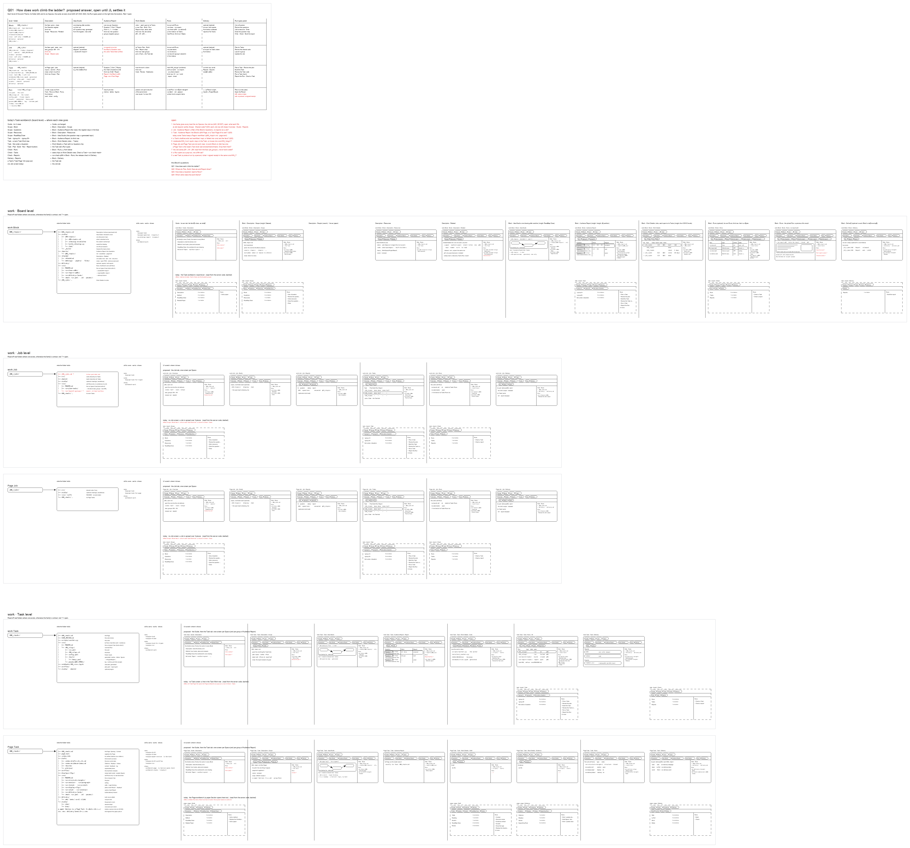

# s01 · How work climbs the ladder

One drawing for every work row, Block down to Run: today's workbench against the proposed ladder (Q01).

- [question] What Q01 asks <!-- n01 -->
  → So what would one drawing have to show to answer it?
  - [asks] What each level holds and shows on screen <!-- n02 -->
    What do the task Block, a work Job, a work Task and a hard Run each hold and show on screen, and which of today's Scope, Task, Check and Delivery Views moves to which level? See [the Block face](../../board.md).
  - [guess] Block keeps Questions, Job its Tasks, Task its Runs <!-- n03 -->
    The hypothesis: the Block keeps its Questions (Audience Report) and Job series (Work Details groups); a Job's Work Details are its Tasks; a Task's Runs are its tickets; a Question's report reads them.
  - [done when] Every level names its folder and six Spaces <!-- n04 -->
    Answered when every level names its folder and its six Spaces' content, drawn in studio/.
- [answer] The Q01 frame: one grid <!-- n05 -->
  → Where do those rows come from, and who keeps them?
  - [rows] One row per level: Block, Job, Task, Run <!-- n06 -->
  - [columns] One column per Space <!-- n07 -->
    Description | Idea Studio · Audience Report | Work Details | Runs · Delivery | the Run types panel, with each level's folder on the left.
  - [moves] Where each of today's Task views goes <!-- n08 -->
  - [open] Nine open points, drawn in red <!-- n09 -->
- [levels] Board, Job and Task, row by row <!-- n10 -->
  → Who owns those definitions?
  - [each row] Its folder, what it holds, its skills, its screens <!-- n11 -->
  - [proposed] Teal and solid, on top <!-- n12 -->
  - [today] Grey and dashed, underneath <!-- n13 -->
    The proposal sits above today's workbench on each row, so the change reads at a glance.
- [source] Defined once, in b10 <!-- n14 -->
  → Then what does it settle, and what is still open?
  - [here] The Q01 frame is this folder's own <!-- n15 -->
    [build_s01_work_ladder.py](build_s01_work_ladder.py): its `GRID`, `MOVES` and `OPEN` tables.
  - [shared] The level rows come from b10's s01 <!-- n16 -->
    `b10_project_workbench/studio/s01-overall-tree-structure/` (`build_ladder_v4.py`, `level_views.py`).
  - [rule] Edit them there; this drawing follows <!-- n17 -->
- [status] Feeds Q01, still proposed <!-- n18 -->
  → Which open point decides the rest?
  - [feeds] The ladder question's report <!-- n19 -->
    [q01_work_ladder](../../reports/q01_work_ladder/q01_work_ladder.md)
  - [decided] Nothing yet: proposed on 261007 <!-- n20 -->
    Q01 stays open until JL settles it.
- [open] The nine red points <!-- n21 -->
  - [first] Does the work Job take the Block's six Spaces? <!-- n22 -->
  - [then] b03's work Job row follows that answer <!-- n23 -->
    If the work Job takes the Block's six Spaces, b03's work Job row follows; its owner, b03, changes it.
  - [where] Listed under Limits in Q01's report <!-- n24 -->
- [files] What the folder holds <!-- @files #6ce6c5 -->
  - [py] [build_s01_work_ladder.py](build_s01_work_ladder.py) <!-- @files/0 #c3da0c -->
  - [excalidraw] [s01-work-ladder.excalidraw](s01-work-ladder.excalidraw) <!-- @files/1 #7b5eab -->
  - [md] [s01-work-ladder.md](s01-work-ladder.md) <!-- @files/2 #f08117 -->
  - [png] [s01-work-ladder.png](s01-work-ladder.png) <!-- @files/3 #031882 -->
    
