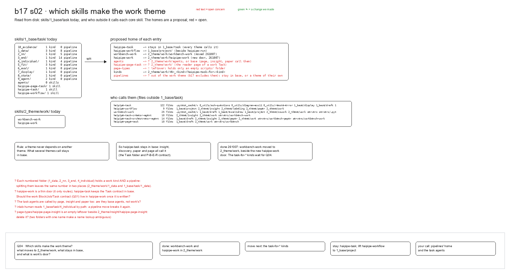

# s02 · Which skills make the work theme

Read from disk: what skills/1_base/task holds and who outside it calls each core skill; the homes are a proposal (Q04).

- [today] What 1_base/task held on 261007 <!-- n01 -->
  → Who outside 1_base/task calls them?
  - [kinds] Ten numbered folders: a work kind beside a pipeline <!-- n02 -->
    10_evidence 1 kind · 1_data 3 kinds, 8 pipeline skills · 2_nn 1, 5 · 3_end 1, 14 · 4_individual 1, 4 · 5_fit 3 · 6_eval 1 · 7_display 1 · 8_stata 1 · 9_agent 2.
  - [core] Four core folders: agents, page-task, task, workflow <!-- n03 -->
  - [work] 2_theme/work held workbench-work and haipipe-work <!-- n04 -->
- [callers] Who calls each core skill <!-- n05 -->
  → So which rule decides where each goes?
  - [haipipe-task] 122 files, across every theme <!-- n06 -->
  - [workflow] 9 files: project, insight, labeling, paper, work <!-- n07 -->
  - [workbench-work] 25 files, servers included <!-- n08 -->
  - [agents] 10 and 14 files: insight, paper, work <!-- n09 -->
    haipipe-task-creator-agent 10 files; haipipe-task-orchestrator-agent 14 files (draft, insight, paper, work, two servers).
  - [page-task] 10 files: draft, work, the server <!-- n10 -->
- [rule] A theme never depends on another theme <!-- n11 -->
  → Then where does each entry go?
  - [rule] What several themes call stays in base <!-- n12 -->
  - [so] haipipe-task stays in base <!-- n13 -->
    Insight, discovery, paper and page all call it: the Task folder and its Plan · Build · Execute · Report contract.
- [homes] The proposed home of each entry <!-- n14 -->
  → What did the drawing leave open?
  - [stays] haipipe-task stays in 1_base/task <!-- n15 -->
  - [lift] haipipe-workflow goes beside haipipe-run <!-- n16 -->
  - [moved] workbench-work moved to 2_theme/work (261007) <!-- n17 -->
  - [new] haipipe-work: the work theme's new door <!-- n18 -->
  - [kinds] task-for-* kinds to 2_theme/work/<N>_<kind>/ <!-- n19 -->
  - [?] agents and page-task: work's own, or base? <!-- n20 -->
  - [leftover] page-types held only an empty folder <!-- n21 -->
- [open] Five open concerns <!-- n22 -->
  → Where does Q04 stand, and what has happened since?
  - [split] A numbered folder mixes a kind and a pipeline <!-- n23 -->
    Splitting them leaves one number in two places (2_theme/work/1_data and 1_base/task/1_data).
  - [door] Should the work contract (Q01) live in haipipe-work? <!-- n24 -->
  - [agents] Page, insight, paper call the task agents too <!-- n25 -->
  - [path] inlab-human reads 4_individual by path <!-- n26 -->
  - [duplicate] Two folders named haipipe-page-insight <!-- n27 -->
- [since] Since 261007, checked on 261026 <!-- n28 -->
  - [done] haipipe-page-task merged into haipipe-task (261021) <!-- n29 -->
  - [done] Workflows are haipipe-run's; haipipe-workflow is gone <!-- n30 -->
  - [done] The empty page-types leftover is gone <!-- n31 -->
  - [still] The task-for-* kinds are still in 1_base/task <!-- n32 -->
  - [open] Q04: the pipelines' home and the agents <!-- n33 -->
    [q04_work_skills](../../reports/q04_work_skills/q04_work_skills.md)
- [files] What the folder holds <!-- @files #6ce6c5 -->
  - [py] [build_s02_work_skills.py](build_s02_work_skills.py) <!-- @files/0 #22bd8e -->
  - [excalidraw] [s02-work-skills.excalidraw](s02-work-skills.excalidraw) <!-- @files/1 #209794 -->
  - [md] [s02-work-skills.md](s02-work-skills.md) <!-- @files/2 #552919 -->
  - [png] [s02-work-skills.png](s02-work-skills.png) <!-- @files/3 #aab0a3 -->
    
