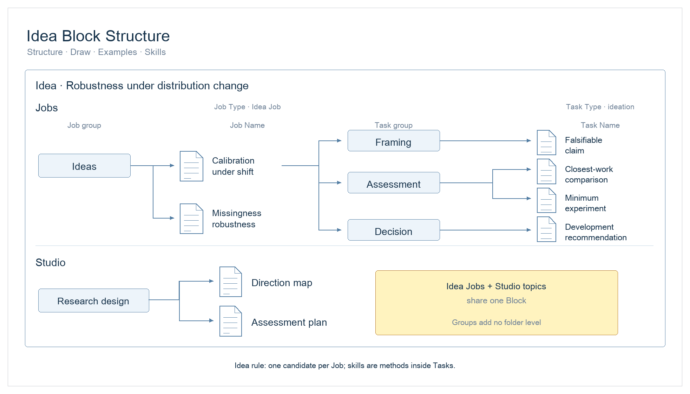

s01 · Block Structure: Idea
==========================================
view: overview

**Tags:** `Structure`

**Studio Type:** [Block Structure](../../b17_theme_work/s71-studio-type-block-structure/elements.md).

**For:** the folder, Job/Task types and Studio organization of a Idea Block.

**Delivery type:** skill

**Topic:** Define a Idea Block through the shared Block Structure Studio Type, with real skill sources and explicit execution boundaries.

**Source:** [Shared Block Structure requirements](../../b17_theme_work/s71-studio-type-block-structure/elements.md), [type catalog](types.md), [Studio organization](structure/studio.md).

**Files:** Structure reads the Folder, Job-Task and Studio outlines through the shared folder-tree renderer. Level colours and hover purposes follow S71. Type views read types.md; Draw opens one canvas; Examples opens real Block views.

**Example:** [Idea-Example](../../../paper/Idea-Example/board.md). Examples reads its actual Folder, Jobs and Studio through the shared Block page. Content is illustrative; scientific results, completed assessments and human selection are not asserted.

## Design record

Folder trees
 (261127)
---------------------

[Folder, Job / Task Organization and Studio Organization](structure/idea-organization.html) are folder trees drawn like b17's s01: Structure folds them, Draw opens every row, Examples shows the j01_calibration and j02_missingness Jobs from hai-ideation's idea-block.md. Jobs and Tasks are folders; groups are labels. Built by `delivery/page-spec/build_idea_organization.py` with b17's shared `tree_html`.

Connected organization map (earlier)
------------------------------------

[Job Type → Job Name → Task Type → Task Name](structure/jobs.html) is the primary organization in both Structure and Draw. Each parent appears once in its branch. Group labels remain metadata, not extra type levels. Jobs without mapped Tasks end at the Job Name. Names describe design examples; † marks a missing contract and ‡ marks a legacy type conflict. The existing Excalidraw canvas remains an Overview of groups and Studio topics.

The user clarified: “不是，我意思是做一个mind map一样的炊，你懂吗。” (2026-11-27, verified in the Work session). This presentation supersedes the earlier table/combined-node overview as the primary organization view.


Idea structure
--------------



Grouping metadata follows **Job topic → Job → Task topic → Task**; the primary map uses the four type/name levels above. The second branch
is **Studio group → Studio topic**, owned by the same Block.

| Thing | Idea content in this design | What it means on disk |
| --- | --- | --- |
| Job topic | Ideas | The default grouping of candidate Jobs; meaningful sub-directions may be used when needed. |
| Job | Calibration under shift · Missingness robustness | Each candidate has its own `jNN_<idea>/` record and canonical Idea Card. |
| Task topic | Framing · Assessment · Decision | Optional navigation lenses over the selected candidate's Tasks; no extra folder level. |
| Task | Falsifiable claim · Closest-work comparison · Minimum experiment · Development recommendation | Bounded question/deliverable records inside the candidate Job. |
| Studio group | Research design | A proposed tag group for shared reasoning, ordered by the Block. |
| Studio topic | Direction map · Assessment plan | Proposed `sNN-<topic>/` records beside the Block's Jobs. |

The drawing is an **illustrative design**, grounded in the owner contract's
Robustness under distribution change direction and calibration/missingness
candidates. It does not claim these Jobs, Tasks, assessments or Studio topics
exist in a live Block. Calibration under shift is expanded; another candidate
uses the same hierarchy with its own questions and deliverables.

Use **Ideas** until genuine sub-directions make a more specific Job grouping
useful. Framing, Assessment and Decision are proposed lenses, not a required
sequence. The owner offers the following deliverables; choose only those needed:

| Task topic | Named Task deliverables | What the result establishes |
| --- | --- | --- |
| Framing | Falsifiable claim | A bounded question, hypothesis and alternatives. |
| Assessment | Closest-work comparison · Refutation and repairs · Minimum experiment | Novelty delta, failure assumptions and a proposed experiment; actual pilot evidence stays linked to Work. |
| Decision | Contribution and target fit · Development recommendation | Target options and a readiness recommendation; selection still requires the person's explicit decision. |

Type and name
-------------

| Job Type | Job Name | Task Type | Task Name |
| --- | --- | --- | --- |
| Idea Job | Calibration under shift | `ideation` | Falsifiable claim |
| Idea Job | Calibration under shift | `ideation` | Closest-work comparison |
| Idea Job | Calibration under shift | `ideation` | Minimum experiment |
| Idea Job | Calibration under shift | `ideation` | Development recommendation |
| Idea Job | Missingness robustness | `ideation` | Missing-input experiment design |

These names are illustrative. A candidate's name distinguishes the Job instance;
the evaluation question or deliverable distinguishes the Task instance. Changing
the candidate, question, skill or reviewer does not create a new type.

**Current binding:** Idea Job is the semantic Job type recognized through
`ideation.yaml` with `kind: ideation-unit`, `layout: idea-job`, the parent index
and one canonical Card. The shared Job face does not define a separate
`job-type: idea` field; introducing that field remains unresolved and this design
does not invent it. Assessment Tasks already declare **`task-type: ideation`**.
A separately requested prose Page uses the existing `draft` Task type.

**Groups remain separate:** Ideas organizes Jobs; Framing, Assessment and Decision
organize Tasks. They do not become type values. Research design groups Studio
topics. The drawing places type labels above the named records and group labels
above the grouping nodes.

Views of this structure Studio
------------------------------

Use the shared **top view → left entries → right content** arrangement.

| Top view | Left entries | Right content |
| --- | --- | --- |
| Structure | Jobs/Tasks · Studio | The named candidate and assessment hierarchy, plus Research design topics, with ownership and real folder meanings. |
| Draw | Jobs & Tasks · Overview | The shared connected organization map; the retained overview canvas. |
| Examples | Actual Idea Block titles, only when bound to real examples | Verified example content and its actual route. Unbound entries and fabricated routes are never shown. |
| Skills | The relevant skill names | Each skill's functions, inputs, outputs, workflow, checks and links to its owning contract. |

**Skills is one view of this same Studio.** A skill's functions remain together
inside its selected content. This design does not allocate separate skill Studios.
The authored manifest installs these views through the shared renderer. Examples
is omitted until a real Idea Block is bound. Candidate Main content remains a
proposal; these Studio controls do not implement that research UI.

Q01 · Answer
------------

**Answer:** Ideas groups candidate Jobs. A selected candidate's Framing,
Assessment and Decision lenses organize named question/deliverable Tasks.
Research design groups the Block's shared reasoning topics. These are navigation
groupings over the existing Block → Job → Task → Run → Result folder ladder.
**Evidence:** [Shared Block page principle](../../../../../PRINCIPLE.md) · [Structure drawing](s01-idea-block-structure.excalidraw).
**Limits:** The named branches are an illustrative design based on the Idea contract; they are not live example records or a mandatory workflow.

Q04 · Answer
------------

**Answer:** The Block's Studio groups organize real `sNN` topics beside its Jobs.
The structure Studio offers Structure, Draw, Examples and Skills views. Structure
contains Jobs/Tasks and Studio as left entries; Skills keeps each selected skill's
functions and checks together. Examples requires actual example Block bindings.
**Evidence:** [Studio ownership](../../../../../plugins/haipipe-toolkit/skills/1_base/project/hai-studio/ref/topic-folder.md).
**Limits:** The Studio view composition is installed through the shared framework;
the complete candidate Main and a live Idea example remain to implement and verify.

Type rules
----------

For an **Idea Block**, the shared structure has these meanings:

- The Block bounds one research direction and owns its pointer-only candidate index.
- One Idea Job owns one candidate question and one canonical Idea Card, with stable
  identity, input revisions, assessments and decision history.
- A Task answers a bounded evaluation question or produces a deliverable. It may
  use several skills or reviewers; a skill invocation does not create another Task.
- Task topic names follow the actual questions. Framing, Assessment and Decision
  can be useful lenses, but they are not mandatory folders or a fixed pipeline.
- A commissioned assessment Run freezes its inputs and close rule. Its authored
  receipt evaluates evidence; it is not a new scientific measurement.
- Work owns new computation and pilot measurements. Discovery owns acquisition of
  sources. Idea Tasks link their original Run/Result addresses.
- A selected Paper handoff pins the source revision and explicit human decision;
  reciprocal origin links preserve the Idea Job in place. Repeated handoff reuses
  the bound destination. Defer, abandon, refine, split and merge remain explicit.
- The same source may support a Grant, or both Paper and Grant, when justified.
  **Grant handoff validation and reciprocal origin records remain proposed.**

A newly admitted Idea Job may have no Tasks yet. A completed assessment or
recommendation never manufactures the person's selection. Changed scientific inputs
advance their semantic revision and invalidate stale selection authority.

On disk
-------

```text
paper/Idea-<direction>/
├── board.md
├── ideation.yaml                  pointer-only candidate index
├── _studio_groups.txt             Studio group order, when used
├── sNN-<topic>/                   Studio topics beside Jobs
│   ├── sNN-<topic>.md
│   └── sNN-<topic>.excalidraw
├── trace/
├── delivery/                     Block-owned outputs, when produced
│   └── jNN_<idea>/tNN_<question>/<lane>/
└── jNN_<idea>/
    ├── jNN_<idea>.md
    ├── ideation.yaml              layout: idea-job; stable idea_id
    ├── cards/iNN_<idea>.yaml       one canonical Idea Card
    ├── workflow/                  assessment and decision receipts
    ├── handoff/                   selected source packet
    └── tNN_<question>/
        ├── tNN_<question>.md
        ├── assessments/
        └── runs/run-assess-<target>/
            ├── run.yaml
            └── passes/pNN-<date>/
```

Folders arrive with their first content. Job topics, Task topics and Studio groups
create no additional nesting. Delivery has one physical root at the Block; child
views select their source subtree. Runs and outputs remain at their original scope.

Inside the Block's Jobs view
---------------------------

The Block keeps its route and title while a reader selects a Job or Task.
Embedded navigation follows **Job topic → Job → Main / Task topic → Task**.
Main hides the Task row and restores its previous selection when Tasks return.

Main has Overview, Tasks and populated Findings. Overview holds a Brief with Goal,
Requirements and MindMap; Findings contains real Values, Displays or Reports.
A selected Task shows its question, source revisions, authored assessment, methods,
Runs, outputs and limits. Feedback and human decisions open beside their source.
These content rules add no extra levels to the shared hierarchy.

Skills view content
-------------------

| Skill | Content to inspect in this view |
| --- | --- |
| `hai-block` | The proposed `structure <type>` function, the Block face and type-owner lookup. |
| `hai-ideation` | Candidate identity, assessment inputs, selection and exact-revision handoff checks. |
| `hai-task` | Task meaning, question, expected output and applicable methods. |
| `hai-run` | Run identity, frozen inputs, passes, outputs and close rules. |

Keep these definitions in their owning skills. The Skills view references them;
it does not copy their implementation or require a separate Studio per skill.

Existing and proposed
---------------------

Idea Block/Job identity, the one-Card contract, assessment Task type, structural
checker and exact-revision Paper selection tests already exist. The generic reader
shows normal faces and links. Studio already groups real topic records by tags.

The named illustrative diagram above, its Framing/Assessment/Decision grouping,
Research design topics and complete candidate Main are design proposals. The authored Studio views are installed; Examples has no live Idea binding and the shared reader omits that empty view. The existing Idea Job Effect is a demonstration,
not a live Idea example or a real Run. Grant handoff remains to implement and verify.

Sources and preserved history
-----------------------------

- [Idea Block owner](../../../../../plugins/haipipe-toolkit/skills/1_base/ideation/hai-ideation/references/idea-block.md)
- [Ideation constitution](../../../../../plugins/haipipe-toolkit/skills/1_base/ideation/hai-ideation/CONSTITUTION.md)
- [Assessment Task contract](../../../../../plugins/haipipe-toolkit/skills/1_base/ideation/hai-ideation/references/assessment-task.md)
- [Registered Task types](../../../../../plugins/haipipe-toolkit/skills/1_base/task/hai-task/ref/types.md)
- [Idea Job recognition](../../../../../plugins/haipipe-toolkit/skills/1_base/ideation/hai-ideation/scripts/idea_layout.py)
- [Shared Job contract](../../../../../plugins/haipipe-toolkit/skills/1_base/project/hai-job/SKILL.md)
- [Shared view layout](../../../../../plugins/haipipe-toolkit/servers/workbench/ref/top-view-left-tab-right-content.md)
- [Idea Job preview](../s11-idea-job-preview/s11-idea-job-preview.md)
- [Work Job UI](../../b17_theme_work/s11-work-job-preview/s11-work-job-preview.md)
- [Earlier Paper boundary decisions](../_archive/20261127/s01-paper-tree-concept/s01-paper-tree-concept.md)
- [Earlier Studio decisions](../_archive/20261127/s02-paper-studio/s02-paper-studio.md)

The last two links name preserved archive destinations. Those records retain their
earlier identities; they do not become decisions of this new Idea topic.

Decided
-------

s01-D01 · Idea, Grant and Paper each have a structure Studio. The request: “Should we have studio s01 for idea block structure. And s02 for grant, s03 for paper block? You can remove the old ones” (2026-11-27).
s01-D02 · One candidate remains one Idea Job. Evaluation questions are Tasks and skills are methods within them (existing Ideation constitution A01).
s01-D03 · Superseded by s01-D06. Earlier guidance was to show general names first: “What are the job topic job name task topic and task name... example 1, example 2, or job 1, job 2” (2026-11-27, relayed from Work).
s01-D04 · Skills is a view of this same structure Studio: “skill might still be into one item in the top view list. No need to have a new studio for it” (2026-11-27, relayed from Work).
s01-D05 · The shared top views are Structure / Draw / Examples / Skills. Structure contains both hierarchies; Examples entries require actual Block bindings (2026-11-27, confirmed user correction relayed from Design).
s01-D06 · Name the actual type's groups, Jobs, Tasks and Studio topics. The correction rejects numbered display labels: “不要再用那个 [Job] 1、[Job] 2、[Job] 3”. For Idea, keep candidates as Jobs and assessment deliverables as Tasks; do not import Paper's groups (2026-11-27, user correction relayed from Paper).
s01-D07 · Distinguish Job Type / Job Name / Task Type / Task Name; group labels stay separate. Use existing Idea layout recognition and the registered `ideation` Task type, with any additional Job-type field explicitly unresolved (2026-11-27, follow-up correction relayed from Work).

Open
----

1. Which real Idea Block should bind Examples and replace the illustrative candidate names with its actual questions?
2. Are Framing/Assessment/Decision and Research design the most useful navigation groups for that Block, or do its actual questions need different group names?
3. Which candidate-specific Main parts can the shared renderer compose directly from the Card and receipts?
4. What does Grant's handoff adapter need beyond the shared source revision and human decision?
5. Should the shared Job contract gain an explicit type field, or should Idea keep its existing layout-based type binding?

Files
-----

- `s01-idea-block-structure.md`: this structure design.
- `s01-idea-block-structure.mindmap.md`: its editable Idea map and type rules.
- `s01-idea-block-structure.ideas.md`: choices still being explored.
- `build_s01_idea_block_structure.py`: drawing builder using the shared kit.
- `s01-idea-block-structure.excalidraw`: the diagram and preserved annotations.
- `.s01-idea-block-structure.seed.json`: shared writer's annotation baseline.
- `s01-idea-block-structure.png`: rendered drawing preview.
