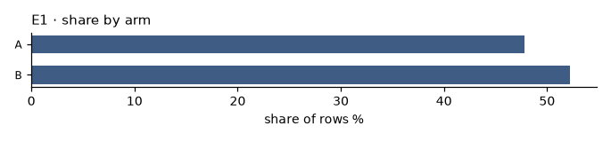
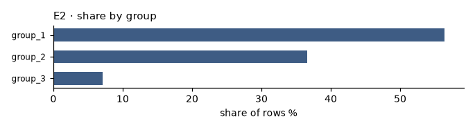

# D02 · arm balance · r01_full

**The ask**: In each segment, how many rows does each arm and each group hold, and what share of the segment is each?

**Run**: ok · 960 of 960 rows · dataset Exampledata-v2 · segment full · ended 2026-11-10T02:39:07Z

Generated by hai-insight ref/run_job.py from this run's results; rerun the ticket `Tools/examples/Project-Ladder/insight/Insight-Example/j02_question-v1-example-questions_data-v2/t02_D02_arm-balance/runs/r01_full/run.sh` to change it.

## D02.E1 · the rows and share of the segment in each arm

- 2 levels; the largest is B at 52.2% (`share_by_arm.csv`)

**Pass**: both arms listed with their counts; an empty arm shown as zero, never dropped

### share_by_arm.csv

| level | n | share_pct |
|---|---|---|
| A | 459 | 47.8 |
| B | 501 | 52.2 |

## D02.E2 · the rows and share of the segment in each group

- 3 levels; the largest is group_1 at 56.4% (`share_by_group.csv`)

**Pass**: every group present in the segment listed; a segment of one group says so

### share_by_group.csv

| level | n | share_pct |
|---|---|---|
| group_1 | 541 | 56.4 |
| group_2 | 351 | 36.6 |
| group_3 | 68 | 7.1 |

## Power, before any contrast

| segment | test | n | base_rate | mde | effect | answerable |
|---|---|---|---|---|---|---|
| full | none | 960 |  |  |  | True |
