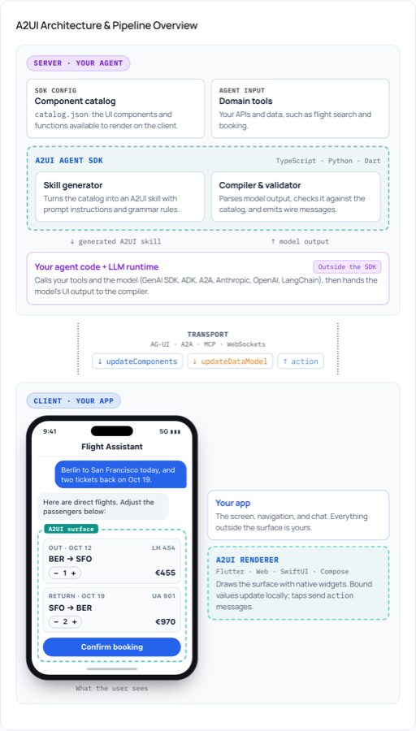
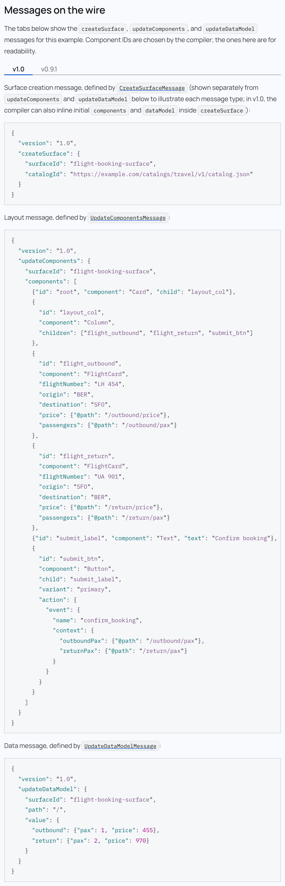
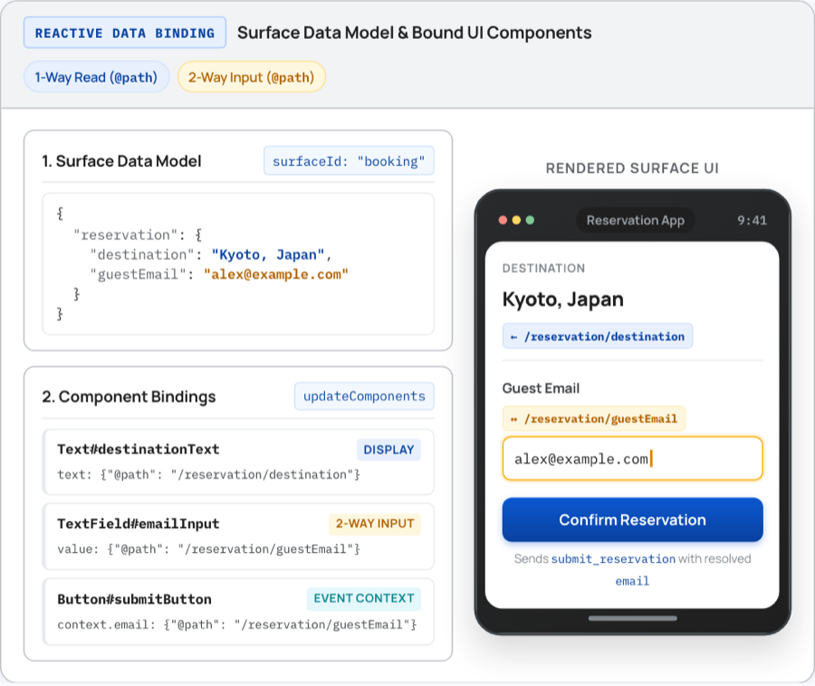
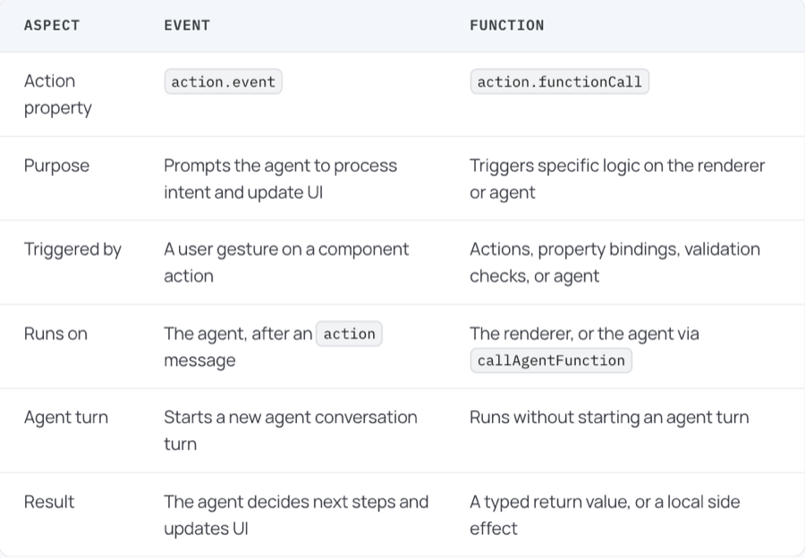
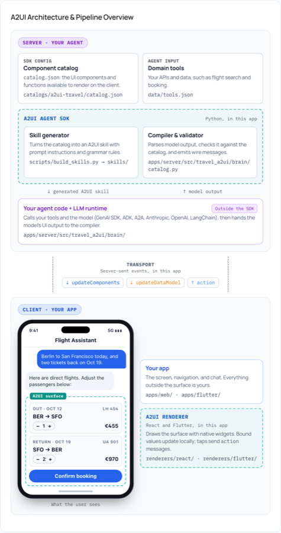

# Official Sources and Versions

Start with the architecture, then follow one interaction. Use the same protocol version throughout the explanation.

## Reading route

1. **Understand the boundary.** Read Resource 1 to separate the agent, transport and renderer.
2. **Follow the data.** Use Resource 2 and Resource 3 to distinguish component structure from values.
3. **Follow the return path.** Read Resource 4 before tracing a user action in s21.
4. **Choose a runnable reference.** Use Resource 5 when selecting a later practice, and Resource 6 for its implementation.

## Source records

These records are the shared reference list for this Block. The other topics cite their IDs.

### Resource 1 · Architecture

[Overview: How A2UI Works](https://a2ui.org/concepts/overview/)

**In the picture:** Berlin to San Francisco: the agent sends cards, + changes passengers locally, Confirm sends action.

Read **Step-by-step generation**, **Render on the client**, and **Handle user actions**. Supports s11 and s21.

### Resource 2 · Messages

[Messages](https://a2ui.org/concepts/messages/)

**In the picture:** The same flight screen as three JSON messages: create the surface, lay out, fill the values.

Locate `createSurface`, `updateComponents`, `updateDataModel`, and `deleteSurface` on this page. Supports s11.

### Resource 3 · Data binding

[Data Model and Data Binding](https://a2ui.org/concepts/data-binding/)

**In the picture:** Kyoto, Japan sits once in the data model; a heading reads it, the email field writes it.

Read the path-reference examples and reactive binding explanation. Supports s11 and s21.

### Resource 4 · Actions

[Actions, Events and Functions](https://a2ui.org/concepts/actions-and-functions/)

**In the picture:** An Event asks the agent and starts its turn; a Function runs without one (openUrl).

Locate event actions, local functions, and the renderer-to-agent `action` message. Supports s21.

### Resource 5 · Quickstart

[Quickstart](https://a2ui.org/quickstart/)

**In the picture:** Travel A2UI: one Python server, a React web client and a Flutter phone client.

Read **How A2UI fits into this app** and **What you will learn**. The current walkthrough uses Travel A2UI with a Python agent and React / Flutter clients. Use it as a reference, not as evidence that this Block has executed it. Supports s31.

### Resource 6 · Repository

[Official A2UI repository](https://github.com/a2ui-project/a2ui)

**In the picture:** Cards, forms, lists: what A2UI draws with native widgets on every platform.

Read **Architecture** and **When to use A2UI** in the README. Before running code, record a release or commit and the exact sample path. Supports s31 and any future practice Job.

Images: official A2UI docs and README, Apache-2.0; sources in `../assets/SOURCES.md`.

## Version choice

The inspected documentation exposes v1.0 and v0.9.1. These learning notes use the **v1.0** examples. A code checkout and package versions must be pinned together before an executable practice. Do not combine a v0.9 path expression with a v1.0 message and call it a validated example.

## Try explaining

Pick one claim from s11. Identify its source ID, the relevant section, and the protocol version. Explain what would have to be checked again if that version changed.
