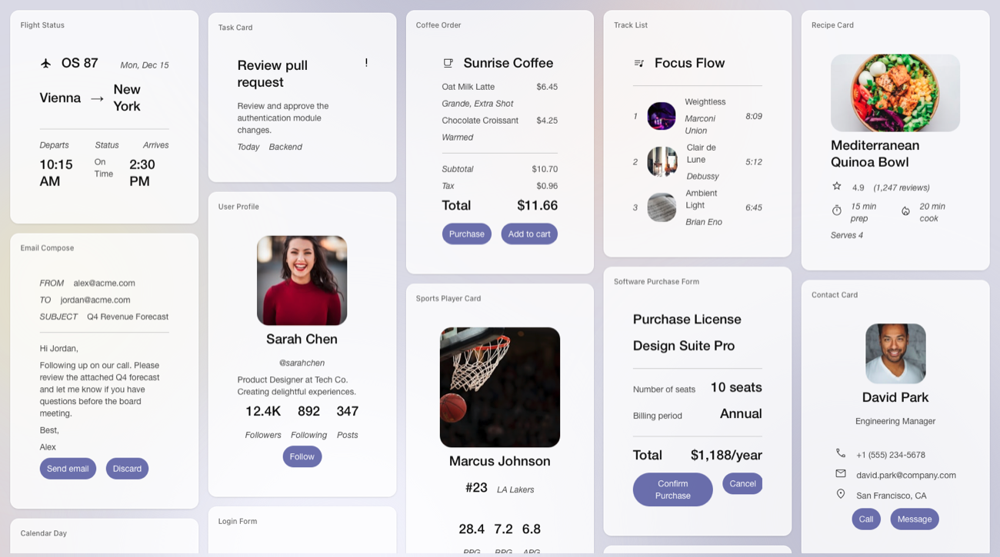

# Official Sources and Versions

## Reading route

**Read the architecture first, then follow one tap; keep one version throughout.**

1. 🏗️ **The boundary:** Resource 1 separates the agent, the transport and the renderer.
2. 🧱 **The data:** Resources 2 and 3 tell structure apart from values.
3. 👆 **The return path:** Resource 4, before tracing a tap in s21.
4. 🧪 **A runnable reference:** Resource 5 to choose a practice, Resource 6 for its code.

## Source records

**Six sources; every other topic cites them by number.**

### Resource 1 · Architecture

🔗 [Overview: How A2UI Works](https://a2ui.org/concepts/overview/)

**In the picture:** Berlin to San Francisco: the agent sends cards, + changes passengers locally, Confirm sends action.

- 📖 **Read:** Step-by-step generation · Render on the client · Handle user actions
- 💡 **Key idea:** purple is your code, the teal dashed boxes are the A2UI SDK on each side
- 🔗 **Used by:** s11, s21

🔍 **Look for:** the purple boxes (your code) and the teal dashed boxes (the A2UI SDK) on the server and in the app

✅ **You know it when:** you can say which boxes are yours and which come from A2UI.

### Resource 2 · Messages

🔗 [Messages](https://a2ui.org/concepts/messages/)

**In the picture:** The same flight screen as three JSON messages: create the surface, lay out, fill the values.

- 📖 **Read:** 🆕 `createSurface` · 🧱 `updateComponents` · 🔢 `updateDataModel` · 🗑️ `deleteSurface`
- 💡 **Key idea:** every message is JSON with a `"version"` and one message key
- 🔗 **Used by:** s11, s42 (the messages as text)

🔍 **Look for:** the `surfaceId` and the one message key at the top of each message

✅ **You know it when:** you can name what each of the four messages does to a surface.

### Resource 3 · Data binding

🔗 [Data Model and Data Binding](https://a2ui.org/concepts/data-binding/)

**In the picture:** Kyoto, Japan sits once in the data model; a heading reads it, the email field writes it.

- 📖 **Read:** the path examples · two-way binding · lists from a template
- 💡 **Key idea:** a component points at a path; only widgets bound to a changed path update
- 🔗 **Used by:** s11, s21

🔍 **Look for:** "Kyoto, Japan" stored once in the data model and shown in two places

✅ **You know it when:** you can say which widgets update when one path changes.

### Resource 4 · Actions

🔗 [Actions, Events and Functions](https://a2ui.org/concepts/actions-and-functions/)

**In the picture:** An Event asks the agent and starts its turn; a Function runs without one (openUrl).

- 📖 **Read:** event actions · local functions · the renderer-to-agent `action` message
- 💡 **Key idea:** 📤 an Event goes to the agent; 🏠 a Function can stay on the device
- 🔗 **Used by:** s21

🔍 **Look for:** the Agent turn row of the Event and Function table

✅ **You know it when:** you can say which taps reach the agent and which stay on the device.

### Resource 5 · Quickstart

🔗 [Quickstart](https://a2ui.org/quickstart/)

**In the picture:** Travel A2UI: one Python server, a React web client and a Flutter phone client.

- 📖 **Read:** How A2UI fits into this app · What you will learn
- 💡 **Key idea:** each part of the pipeline has a real file path in the sample
- ⚠️ A reference to read, not evidence that this Block ran it
- 🔗 **Used by:** s22, s31

🔍 **Look for:** the real file path under each box of the Travel A2UI diagram

✅ **You know it when:** you can find the catalog, the skills and the compiler in the sample.

### Resource 6 · Repository

🔗 [Official A2UI repository](https://github.com/a2ui-project/a2ui)

**In the picture:** Cards, forms, lists: what A2UI draws with native widgets on every platform.

- 📖 **Read:** README › Architecture · When to use A2UI
- 💡 **Key idea:** the packages: Agent SDK, Renderer SDK, Core SDK
- ⚠️ Before running code, record a release or commit and the exact sample path
- 🔗 **Used by:** s22, s31, the practice Job j01

🔍 **Look for:** the three SDK kinds in the README's package tables

✅ **You know it when:** you can name one package for the server and one for your app.

📄 Images: official A2UI docs and README, Apache-2.0; sources in `../assets/SOURCES.md`.

## Version choice

**This Block reads v1.0.**

- 📚 The docs show v1.0 and v0.9.1; these notes use the **v1.0** examples.
- 📌 Before a practice, pin the code checkout and the package versions together.
- ⚠️ Never mix a v0.9 path with a v1.0 message and call it a checked example.

## Try explaining

**Trace one claim back to its source.**

- 🎯 Pick one claim from s11.
- 🔍 Name its Resource, the section and the version.
- 🔄 Say what you would check again if the version changed.
