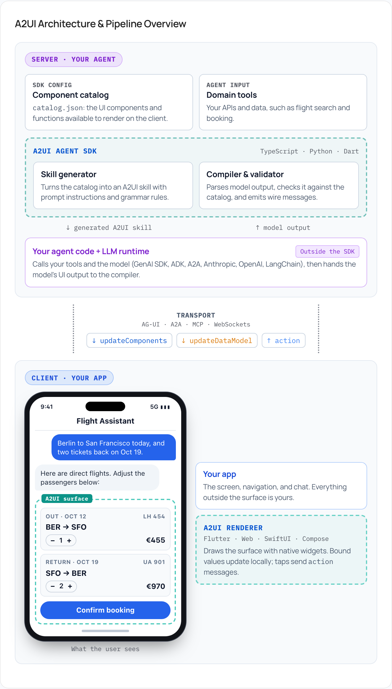

# Resource 1 · Architecture

🔗 [Overview: How A2UI Works](https://a2ui.org/concepts/overview/)

**In the picture:** Berlin to San Francisco: the agent sends cards, + changes passengers locally, Confirm sends action.

- 📖 **Read:** Step-by-step generation · Render on the client · Handle user actions
- 💡 **Key idea:** purple is your code, the teal dashed boxes are the A2UI SDK on each side
- 🔗 **Used by:** s11, s21

🔍 **Look for:** the purple boxes (your code) and the teal dashed boxes (the A2UI SDK) on the server and in the app

✅ **You know it when:** you can say which boxes are yours and which come from A2UI.
