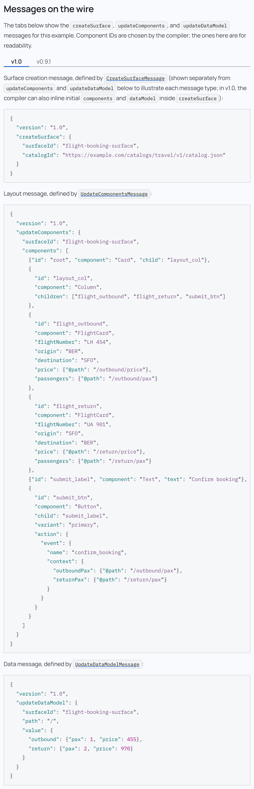

# Resource 2 · Messages

[Messages](https://a2ui.org/concepts/messages/)

**In the picture:** The same flight screen as three JSON messages: create the surface, lay out, fill the values.

Locate `createSurface`, `updateComponents`, `updateDataModel`, and `deleteSurface` on this page. Supports s11.
