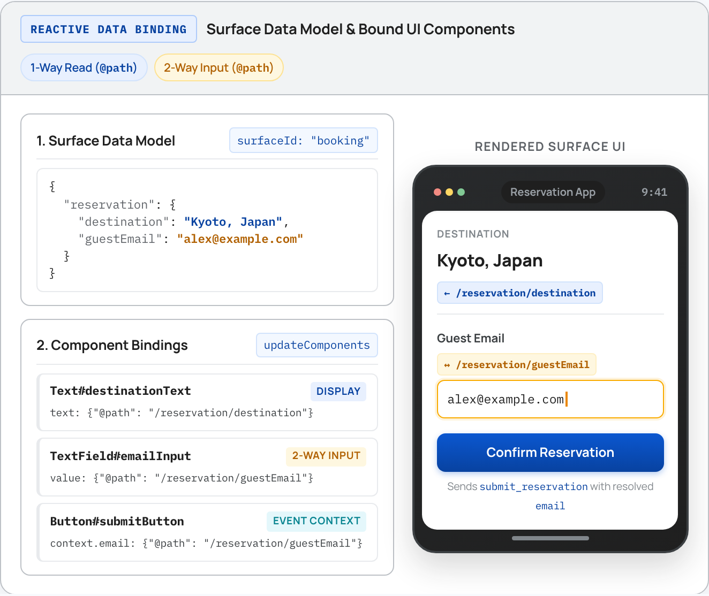

# Resource 3 · Data binding

🔗 [Data Model and Data Binding](https://a2ui.org/concepts/data-binding/)

**In the picture:** Kyoto, Japan sits once in the data model; a heading reads it, the email field writes it.

- 📖 **Read:** the path examples · two-way binding · lists from a template
- 💡 **Key idea:** a component points at a path; only widgets bound to a changed path update
- 🔗 **Used by:** s11, s21

🔍 **Look for:** "Kyoto, Japan" stored once in the data model and shown in two places

✅ **You know it when:** you can say which widgets update when one path changes.
