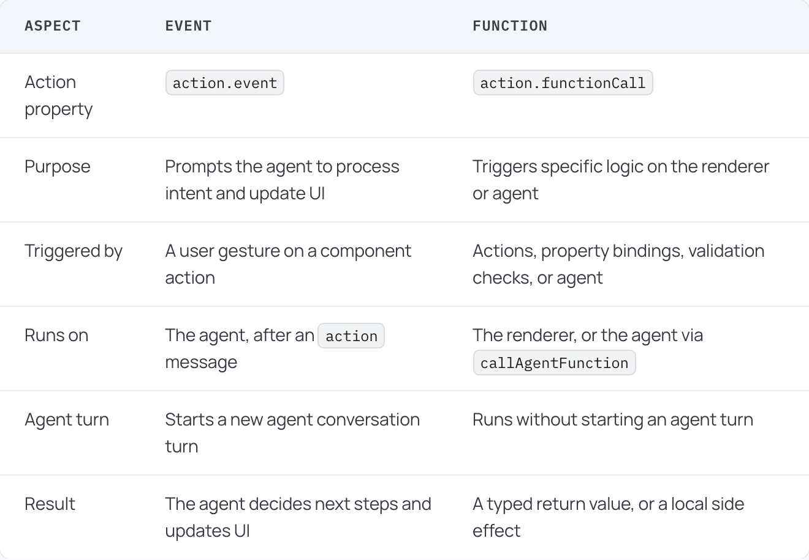

# Resource 4 · Actions

🔗 [Actions, Events and Functions](https://a2ui.org/concepts/actions-and-functions/)

**In the picture:** An Event asks the agent and starts its turn; a Function runs without one (openUrl).

- 📖 **Read:** event actions · local functions · the renderer-to-agent `action` message
- 💡 **Key idea:** 📤 an Event goes to the agent; 🏠 a Function can stay on the device
- 🔗 **Used by:** s21

🔍 **Look for:** the Agent turn row of the Event and Function table

✅ **You know it when:** you can say which taps reach the agent and which stay on the device.
