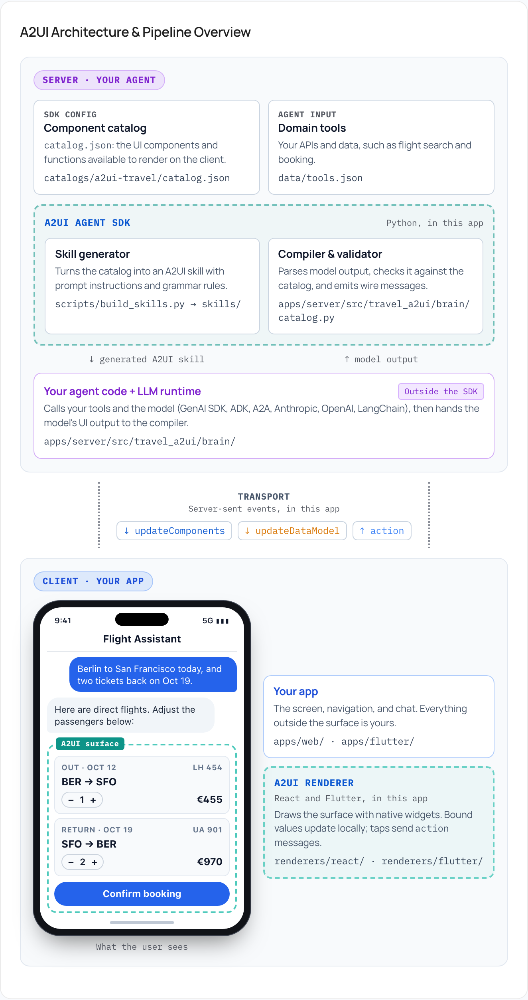

# Resource 5 · Quickstart

🔗 [Quickstart](https://a2ui.org/quickstart/)

**In the picture:** Travel A2UI: one Python server, a React web client and a Flutter phone client.

- 📖 **Read:** How A2UI fits into this app · What you will learn
- 💡 **Key idea:** each part of the pipeline has a real file path in the sample
- ⚠️ A reference to read, not evidence that this Block ran it
- 🔗 **Used by:** s22, s31

🔍 **Look for:** the real file path under each box of the Travel A2UI diagram

✅ **You know it when:** you can find the catalog, the skills and the compiler in the sample.
