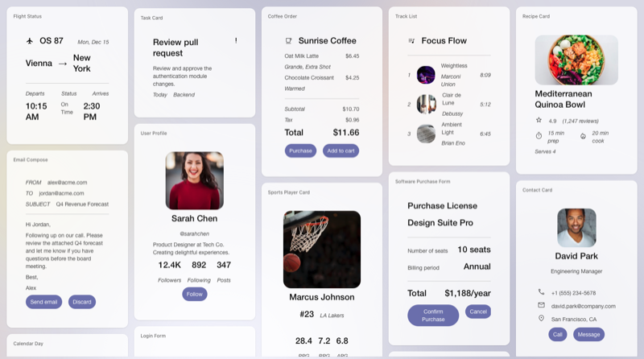

# Resource 6 · Repository

[Official A2UI repository](https://github.com/a2ui-project/a2ui)

**In the picture:** Cards, forms, lists: what A2UI draws with native widgets on every platform.

Read **Architecture** and **When to use A2UI** in the README. Before running code, record a release or commit and the exact sample path. Supports s31 and any future practice Job.

Images: official A2UI docs and README, Apache-2.0; sources in `../assets/SOURCES.md`.
