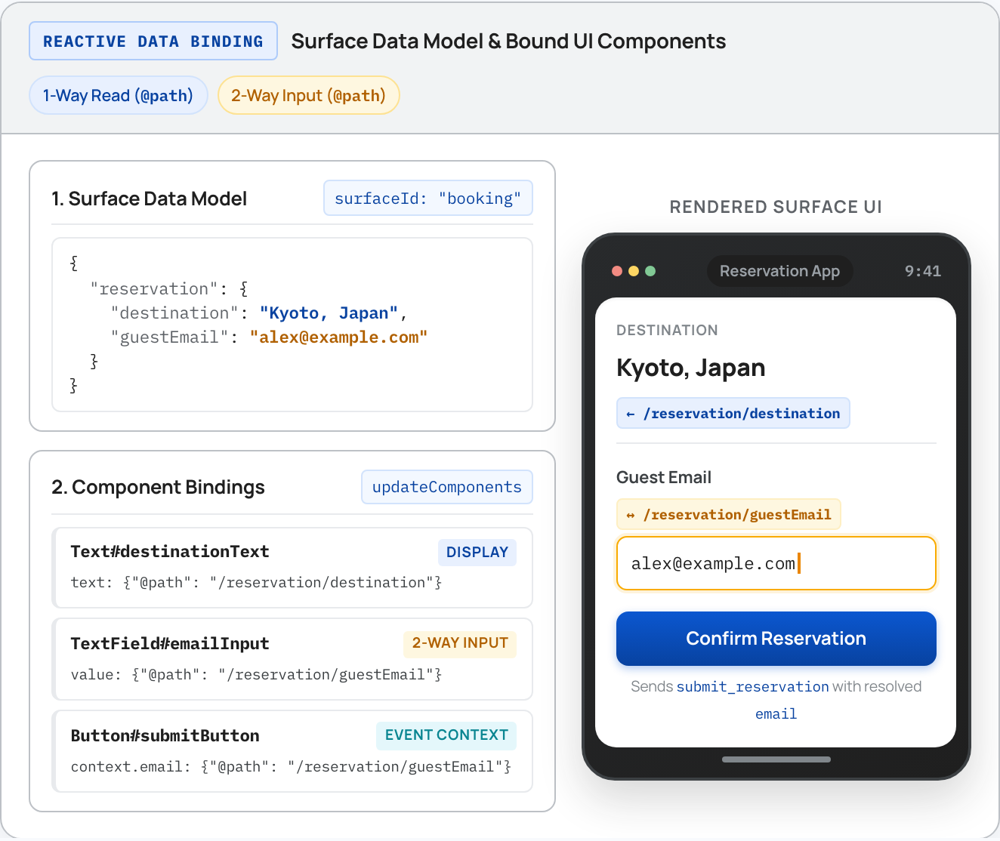

# Messages, Components and Data

## Where you start

**One flight card, read with four questions.**

- ✈️ The card shows a flight and a passenger count of 1.
- 🧱 Where the count sits is the card's **structure**.
- 🔢 The count itself, 1, is a **value** in the data model.
- 👆 Raising it to 2 changes the value; the card stays the same card.

| Ask | 🔍 Look at |
|---|---|
| 🆕 Which interface changes? | the surface ID |
| 🧱 Which widget, and where? | component IDs and their children |
| 🔢 Which value is shown? | the data path and its value |
| 📋 Which widgets are allowed? | the app's catalog |

⚠️ A worked example to reason with, not a captured Run.

## 1. Find the surface the message changes

**Every message names one surface, and does one thing to it.**

- 🆕 `createSurface`: opens the surface (`"flight-booking-surface"`)
- 🧱 `updateComponents`: lays out what is on it (Card › Column › FlightCard, Button)
- 🔢 `updateDataModel`: fills in the values (`/outbound/pax = 1`)
- 🗑️ `deleteSurface`: removes it

🔍 **Look for:** the `surfaceId` at the top of each message ([Resource 2](/_board/page?path=%2Fexamples%2FProject-Ladder%2Fknowledge%2Fb18_a2ui_learning%2Fs01-official-sources%2Fdelivery%2Flearning.md))

✅ **You know it when:** you can say which surface a message changes, and how.

## 2. Read the components and the catalog

**Components are the pieces; the catalog says which pieces exist.**

- 🧱 Each component has an ID and names its children by ID, starting from `root`.
- 📋 The app owns the catalog; the agent can only compose from it.
- 📱 The renderer turns each component into a native widget.

🔍 **Look for:** `"component": "FlightCard"` and its `children` list ([Resource 1](/_board/page?path=%2Fexamples%2FProject-Ladder%2Fknowledge%2Fb18_a2ui_learning%2Fs01-official-sources%2Fdelivery%2Flearning.md))

✅ **You know it when:** you can draw the tree `root` › Column › FlightCard from the message.

## 3. Follow the value through the data model

**A component points at a path; the value lives in the data model.**

- 🔗 `passengers: {"@path": "/outbound/pax"}` is a binding, not a number.
- 🔢 The number is in the data model: `/outbound/pax = 1`.
- 🔄 Change the value, and every widget bound to that path updates; the component is not sent again.

🔍 **Look for:** "Kyoto, Japan" stored once and shown in two places ([Resource 3](/_board/page?path=%2Fexamples%2FProject-Ladder%2Fknowledge%2Fb18_a2ui_learning%2Fs01-official-sources%2Fdelivery%2Flearning.md))

✅ **You know it when:** you can say what changes, and what does not, when pax goes from 1 to 2.

## 4. Test your explanation

**Two explanations of the same card; only one predicts an update.**

- ❌ "The agent sends a card." It misses where the changing values live.
- ✅ "The renderer joins the card's structure with its bound values." It predicts why an existing card can update in place.

## Try explaining

**Sketch it, change one value, point.**

- ✏️ Sketch a label that shows a chosen destination.
- 🔄 Change only the chosen value.
- 👉 Point to the part that changes and the part that stays.
- 🗑️ Then explain how removing the whole surface differs from changing a value.
