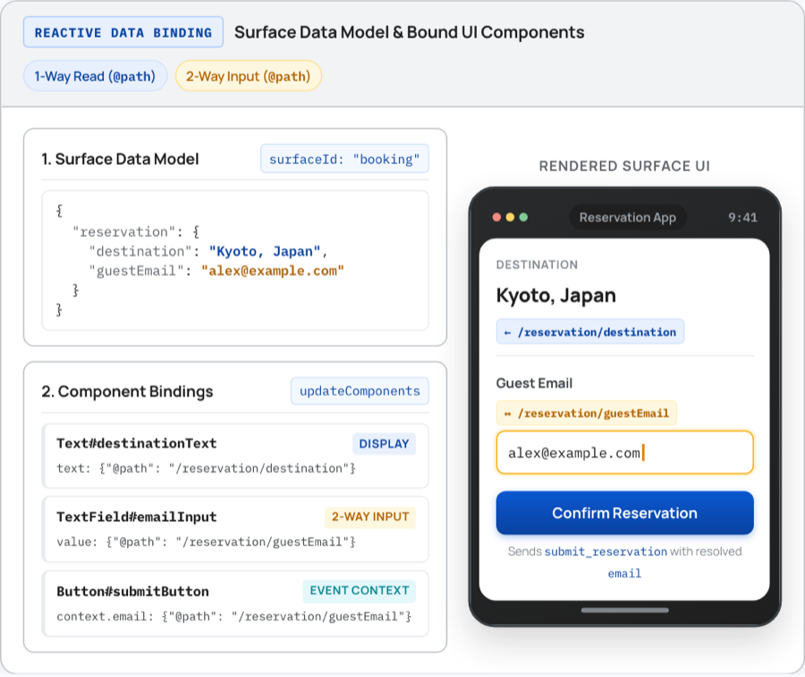

# Three things to distinguish

**A message changes a surface.** `createSurface` establishes it, `updateComponents` supplies component definitions, `updateDataModel` changes values, and `deleteSurface` removes it. A surface identifies the interface being updated. [Resource 2](/_board/page?path=%2Fexamples%2FProject-Ladder%2Fknowledge%2Fb18_a2ui_learning%2Fs01-official-sources%2Fdelivery%2Flearning.md)

**A component describes a piece of the interface.** IDs connect components into a hierarchy. The client resolves permitted component types through its catalog and renders native widgets. The app supplies that catalog; the agent composes within it. [Resource 1](/_board/page?path=%2Fexamples%2FProject-Ladder%2Fknowledge%2Fb18_a2ui_learning%2Fs01-official-sources%2Fdelivery%2Flearning.md)

**The data model holds values.** A binding references a path instead of embedding a fixed value in a component. A value change can therefore update the bound presentation without replacing the whole component description. [Resource 3](/_board/page?path=%2Fexamples%2FProject-Ladder%2Fknowledge%2Fb18_a2ui_learning%2Fs01-official-sources%2Fdelivery%2Flearning.md)

