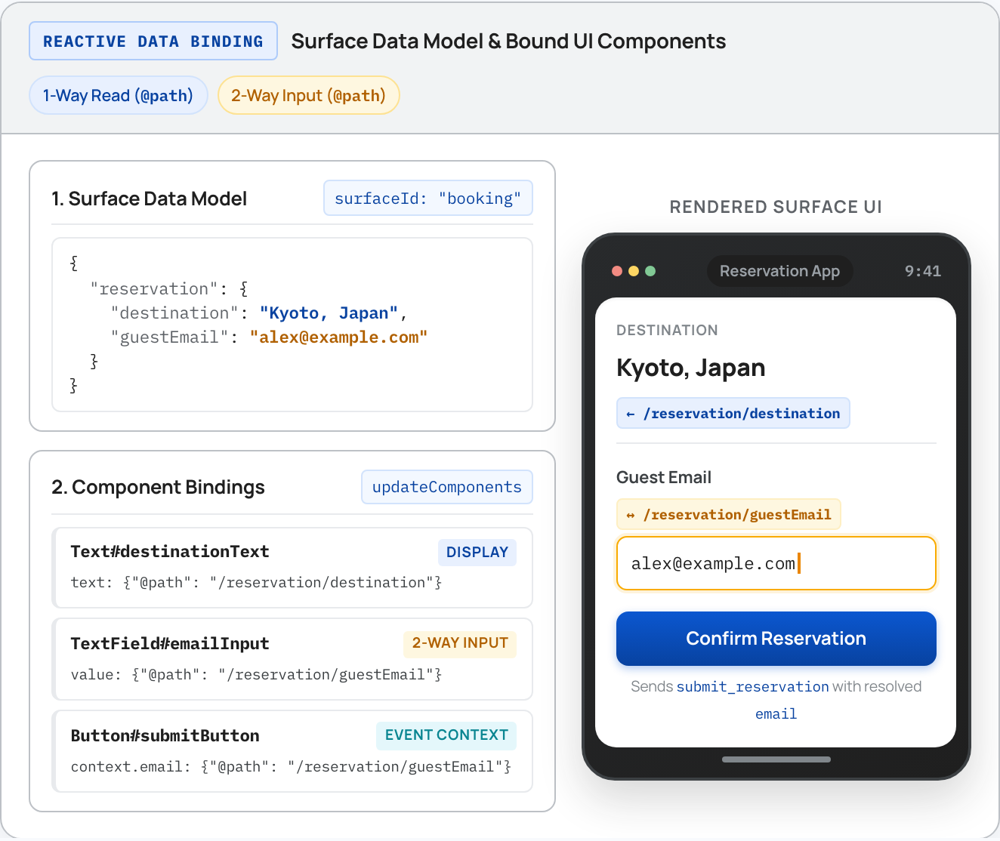

# 3. Follow the value through the data model

**A component points at a path; the value lives in the data model.**

- 🔗 `passengers: {"@path": "/outbound/pax"}` is a binding, not a number.
- 🔢 The number is in the data model: `/outbound/pax = 1`.
- 🔄 Change the value, and every widget bound to that path updates; the component is not sent again.

🔍 **Look for:** "Kyoto, Japan" stored once and shown in two places ([Resource 3](/_board/page?path=%2Fexamples%2FProject-Ladder%2Fknowledge%2Fb18_a2ui_learning%2Fs01-official-sources%2Fdelivery%2Flearning.md))

✅ **You know it when:** you can say what changes, and what does not, when pax goes from 1 to 2.
