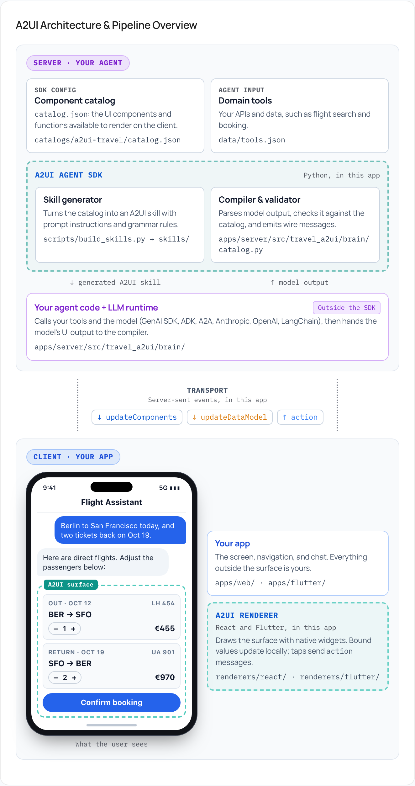

# From a Text Chatbot to A2UI, Step by Step

## Where you start

**Your chatbot today answers in text; six steps add an interface beside it.**

- 💬 Today: your instructions and tools → the model → text → a chat bubble.
- ♻️ Nothing is thrown away: the model, the tools and the chat stay.
- 🖥️ Steps 1 to 4 are on your server; 📱 steps 5 and 6 are in your app.

| 🧰 Kind | What it does | 📦 Packages |
|---|---|---|
| Agent SDK | makes the skill, compiles the model's output | Python `a2ui-agent-sdk` · TypeScript `@a2ui/agent` · Dart `a2ui_agent` |
| Renderer SDK | draws the surface with native widgets | `@a2ui/react` · `@a2ui/lit` · `@a2ui/angular` · `a2ui_flutter` · SwiftUI · Jetpack Compose |
| Core SDK | the protocol, used inside both | `a2ui-core` · `@a2ui/web_core` · `a2ui_core` |

## 1. Choose the catalog

**Decide which components the agent may draw.**

- ✏️ **Change:** pick the components and functions the app allows.
- 🧰 **Tool:** the Basic Catalog, built into every official renderer: `Text`, `Row`, `Column`, `List`, `Button`, `TextField` and more.
- 📂 **In Travel A2UI:** `catalogs/a2ui-travel/catalog.json` adds `FlightOption`, `HotelCard`, `DateRangePicker`, `PriceSummary`.
- 🛡️ The catalog is the guardrail: the agent can only ask for what the app can draw.

✅ **You know it when:** you can list the components your first screen needs, and which are already basic.

## 2. Generate the skill and add it to the prompt

**Your prompt gets one more part; you do not write it by hand.**

- ✏️ **Change:** add the generated skill beside your own instructions and tools.
- 🧰 **Tool:** the Agent SDK's `SkillGenerator` (inside it, `PromptGenerator`) writes a Markdown skill from the catalog.
- 📄 **What it teaches:** the Express grammar, and one signature per component, e.g. `FlightOption(airline, departTime, arriveTime, origin, destination, price, action, ...)`.
- 📂 **In Travel A2UI:** `scripts/build_skills.py` writes `skills/`; rerun it when the catalog changes.

✅ **You know it when:** you can point at where the skill joins your prompt.

## 3. Compile the model's output

**The model's answer goes through the SDK before it leaves your server.**

- ✏️ **Change:** pass the answer to the SDK instead of straight to the app.
- 🧰 **Tool:** `A2uiGenerator` (Express by default); streaming `open_stream` / `openStream`, one-shot `parse_response` / `parseResponse`.
- 🔀 It splits the chat text from the `<a2ui>` block.
- ✅ It checks each statement against the catalog, then emits JSON messages.
- ⚠️ Invalid output is not sent; it can go back to the model to fix (s41, s42).
- 📂 **In Travel A2UI:** `apps/server/src/travel_a2ui/brain/catalog.py`

✅ **You know it when:** you can say what reaches the app when the model makes a mistake.

## 4. Send the messages

**The JSON travels beside the text.**

- ✏️ **Change:** send the messages on a channel the app listens to.
- 🧰 **Tool:** your own channel, or an official integration: `a2ui-a2a`, `a2ui-adk`, AG-UI, MCP, a WebSocket.
- 📂 **In Travel A2UI:** server-sent events.

✅ **You know it when:** you can name the channel your app already uses.

## 5. Render in the app

**The app hosts a renderer in one region of the screen.**

- ✏️ **Change:** add a surface; navigation and chat stay your own code.
- 🧰 **Tool:** a Renderer SDK: `@a2ui/react`, `@a2ui/lit`, `@a2ui/angular`, `a2ui_flutter`, SwiftUI, Jetpack Compose.
- 🔢 It applies `createSurface`, `updateComponents`, `updateDataModel` and keeps bound values live.
- 📂 **In Travel A2UI:** `renderers/react/` and `renderers/flutter/`, used by `apps/web/` and `apps/flutter/`.

✅ **You know it when:** you can show where on your screen the surface sits.

## 6. Handle actions

**A tap on a button reaches your agent; a local edit does not.**

- 👆 **A button:** the renderer sends an `action` message (e.g. `confirm_booking` with the passenger counts).
- 📤 Your server hands it to the agent, which answers with new text and, if needed, new messages.
- 🏠 **A local edit** (the passenger count) needs nothing from the agent.
- 📂 **In Travel A2UI:** the agent in `apps/server/src/travel_a2ui/brain/` receives the event.

✅ **You know it when:** you can say which taps reach the agent and which stay on the phone.

## Try explaining

**Map your own chatbot onto the six steps.**

- ✅ Name the steps it already has: the prompt, the model call, a channel to the app.
- 📦 Name three packages you would add: one for the server, two for a React app.
- 🔗 Say which step each package serves.
