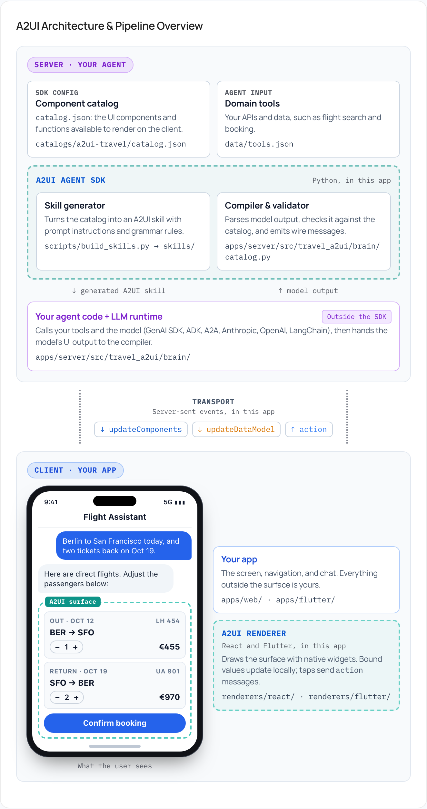

# Where you start

**Your chatbot today answers in text; six steps add an interface beside it.**

- 💬 Today: your instructions and tools → the model → text → a chat bubble.
- ♻️ Nothing is thrown away: the model, the tools and the chat stay.
- 🖥️ Steps 1 to 4 are on your server; 📱 steps 5 and 6 are in your app.

| 🧰 Kind | What it does | 📦 Packages |
|---|---|---|
| Agent SDK | makes the skill, compiles the model's output | Python `a2ui-agent-sdk` · TypeScript `@a2ui/agent` · Dart `a2ui_agent` |
| Renderer SDK | draws the surface with native widgets | `@a2ui/react` · `@a2ui/lit` · `@a2ui/angular` · `a2ui_flutter` · SwiftUI · Jetpack Compose |
| Core SDK | the protocol, used inside both | `a2ui-core` · `@a2ui/web_core` · `a2ui_core` |
