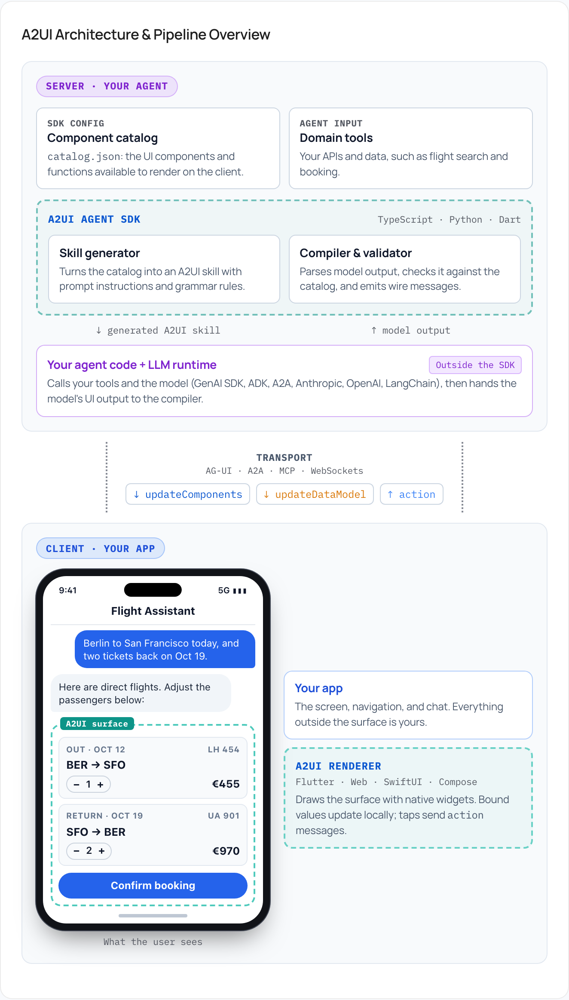

# If My Agent Only Returns Text, What Changes?

## The question

> "suppose I have the agent, only return the text, to use A2UI, do I need to chagne anything?" (2026-11-27)

## Short answer

**Yes, on both sides; the text answer stays.**

- 🖥️ **Your server:** the model learns to describe an interface, and the SDK sends it as A2UI messages.
- 📱 **Your app:** a renderer draws it.
- 💬 **Still there:** the chat text. In the official example the agent writes "Here are direct flights", and two flight cards appear under it.

## On the agent's server

**Four things are added; your agent code stays.**

- 📋 **A catalog:** `catalog.json` lists the components the app allows; the agent cannot use one the app lacks.
- 🧠 **A skill:** the Agent SDK turns the catalog into prompt instructions and grammar rules, added to the model's prompt.
- ✅ **A compiler:** the model's interface output goes to the SDK, which checks it against the catalog.
- 📤 **A transport:** the checked messages (`updateComponents`, `updateDataModel`) go over AG-UI, A2A, MCP or a WebSocket.
- ♻️ **Unchanged:** your agent code and model calls; the official diagram marks them "Outside the SDK".

## In your app

**One renderer, one surface, actions back.**

- 📱 **A renderer:** Flutter, Web (React, Lit, Angular), SwiftUI or Compose.
- 🖼️ **A surface:** one region of the screen it draws; navigation and chat stay your own code.
- 👆 **Actions back:** a tap on a button sends an `action` message to the agent.
- 🏠 **Local edits:** changing a bound value, such as the passenger count, sends nothing.

## The smallest first step

**Start without the model; add one piece at a time.**

1. 🧪 Send fixed A2UI messages from the server (a static payload); the practice Job j01 does this with one card.
2. 🧠 Add the catalog and the SDK, so the model writes the interface.
3. 👆 Handle actions.

🔍 **Look for:** all three steps in one small app, Travel A2UI (Resource 5).

## Follow-up: does the agent now return JSON?

> "for this, previous, agent only return text, now you wwant agent to return json, right? this will be the changes, right? and we need to add the skill of A2UI to our chatbot?" (2026-11-27)

**The model still returns text; your server turns part of it into JSON.**

- 💬 **The model writes two parts:** the chat text, as before, and a block between `<a2ui>` and `</a2ui>` in A2UI Express (`root = Card(Column([FlightCard(...), Button(...)]))`).
- 🧩 It may write the JSON directly instead, but it does not have to.
- ⚙️ **Your server compiles the block:** the SDK checks it against `catalog.json` and emits `createSurface`, `updateComponents`, `updateDataModel`.
- 🧠 **Yes, the chatbot gets the A2UI skill:** generated by the SDK from `catalog.json`, never written by hand; it sits beside your own instructions and tools.

| | 💬 Before | ✨ After |
|---|---|---|
| Prompt | your instructions, your tools | the same, **plus the A2UI skill** |
| The model writes | text | text **plus an `<a2ui>` block** |
| Your server | passes the text on | passes the text on **and compiles the block into JSON** |
| The app | a chat bubble | a chat bubble **and a surface drawn by the renderer** |

## Follow-up: streaming, and broken output

> "so ideal, I need to chnage my chatbot a bit, and then return the the <a2ui> json from my chat bot, right? so it will streaming out like the next token prediction ,right? what is the json is corrupted." (2026-11-27)

**A small change; it streams token by token; broken output is not sent.**

- ✏️ **A small change:** the chatbot keeps its model, tools and conversation; it adds the skill and passes the answer through the SDK.
- 🧩 **Express by default:** if you prefer JSON, the model writes it between `<a2ui-json>` and `</a2ui-json>`.
- 🌊 **It streams:** the SDK reads the answer as it arrives (`open_stream` / `openStream`), splits the chat text from the block, and sends JSON as each statement completes.
- ⚡ **The card appears early:** Express puts `root` first.
- 🛡️ **Broken output is caught:** a missing component, a wrong property or a broken ID is reported as soon as it appears, and can go back to the model to fix.
- 🩹 **Direct JSON is repaired:** the SDK strips Markdown fences and heals half-written strings while streaming.
- 💡 **Why Express:** raw JSON, with nested braces, quotes and hand-written IDs, breaks more often, especially on small models.

| 😟 Worry | 🛡️ What the SDK does |
|---|---|
| The model writes JSON token by token | Express is shorter and breaks less; the SDK writes the JSON |
| A brace or quote is missing | Express needs few; for Direct JSON the SDK repairs strings as they stream |
| A component or property is wrong | checked against the catalog, reported as soon as it appears |
| The output is invalid | not sent to the app; returned to the model to fix |

## Try explaining

**Point at what is new.**

- 🔍 In the Resource 1 diagram, find the two boxes your agent did not have before.
- 💬 Say what each one does with the model's output.
