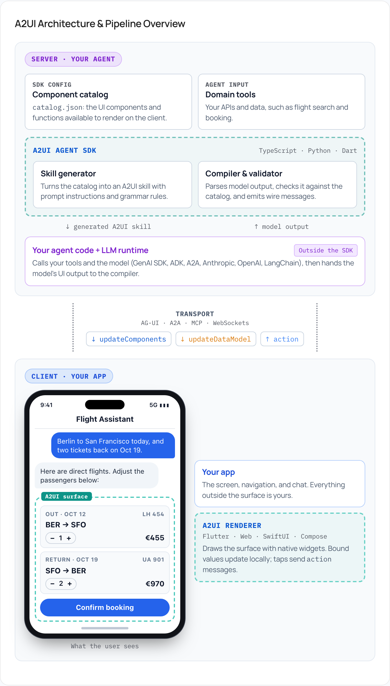

# Short answer

**Yes, on both sides; the text answer stays.**

- 🖥️ **Your server:** the model learns to describe an interface, and the SDK sends it as A2UI messages.
- 📱 **Your app:** a renderer draws it.
- 💬 **Still there:** the chat text. In the official example the agent writes "Here are direct flights", and two flight cards appear under it.

