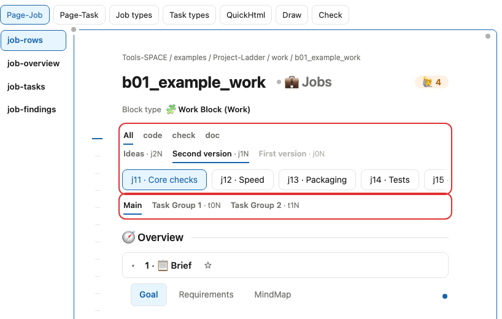

# A Block Job UI Preview topic: a real one

`examples/Project-Ladder/blueprint/b17_theme_work/s11-work-job-preview/`

The Work Block's Job and Task pages as the server draws them, each part of a page a left tab.

Open it in the Block's page, Studio section, to click through it. Copy its shape, never its content: start yours with
`type_follow.py new block-job-ui-preview <topic>`. The picture was taken from the running workbench; retake it when the type changes.
