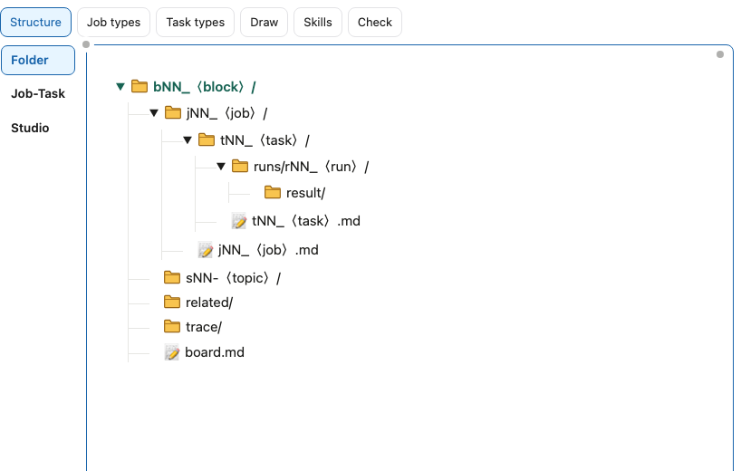

# A Block Structure topic: a real one

`examples/Project-Ladder/blueprint/b17_theme_work/s01-work-structure/`

The Work Block: its Folder, Job-Task and Studio trees under Structure, then one button per level of type it has.

Open it in the Block's page, Studio section, to click through it. Copy its shape, never its content: start yours with
`type_follow.py new block-structure <topic>`. The picture was taken from the running workbench; retake it when the type changes.
