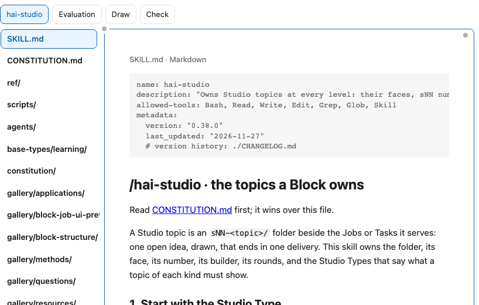

# A Skills topic: a real one

`examples/Project-Ladder/blueprint/b17_theme_work/s60-skill-studio/`

One skill, `hai-studio`: its button on top, its whole folder on the left under the names on disk, then Evaluation, its own drawing and Check.

Open it in the Block's page, Studio section, to click through it. Copy its shape, never its content: start yours with
`type_follow.py new skills <topic>`. The picture was taken from the running workbench; retake it when the type changes.
